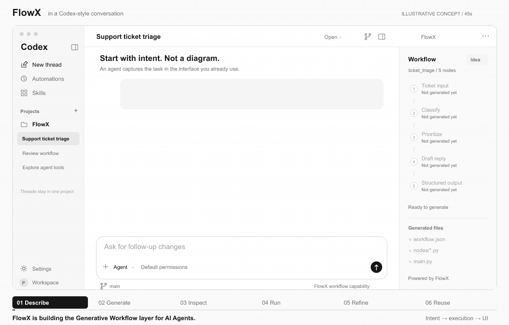
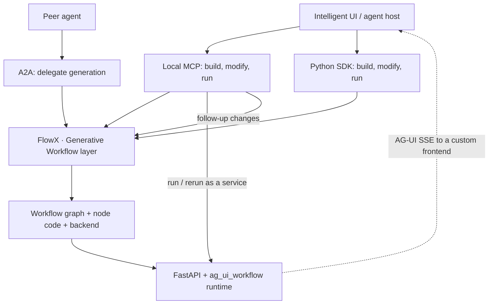
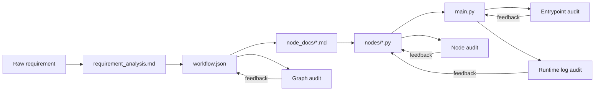

<a name="readme-top"></a>
<!-- Modified 2026-11-02: clarify SDK repair behavior and paused-result fields. -->
<!-- Modified 2026-11-03: document workflow-indexed background builds and review. -->
<!-- Modified 2026-11-03: document the background-only MCP build interface. -->
<!-- Modified 2026-11-03: document installation of the FlowX agent skill. -->
<!-- Modified 2026-11-03: add Hermes Agent skill installation instructions. -->
<!-- Modified 2026-11-04: update skill installation for its move to the repository root. -->
<!-- Modified 2026-11-04: document first-use setup and combined Hermes installation. -->
<!-- Modified 2026-11-04: streamline setup and quick-start guidance. -->
<!-- Modified 2026-11-05: install the complete skill including SDK scripts. -->
<!-- Modified 2026-11-06: document CLI answers for paused node-test repairs. -->
<!-- Modified 2026-11-09: link to the optional DeepSeek Harness plugin. -->
<!-- Modified 2026-11-10: clarify the requested read-only Harness viewer. -->
<!-- Modified 2026-11-11: document optional named workflow allocation. -->

<p align="center">
  
</p>

<h2 align="center">FlowX</h2>
<h3 align="center">Generate, run, and evolve AI agent workflows from natural language</h3>

<p align="center">
  <strong>English</strong> · <a href="README.zh-CN.md">简体中文</a>
</p>

<p align="center">
  
  
  
  
  <a href="https://github.com/AIpRoBuilder/FlowX/stargazers"></a>
  <a href="https://hub.xerj.org/contributors/xiechuxi"></a>
</p>

<p align="center">
  <a href="#setup">⚙️ Setup</a> ·
  <a href="#quickstart">🚀 Quick Start</a> ·
  <a href="#key-features">✨ Key Features</a> ·
  <a href="#tool-surface">🧰 MCP Tools</a> ·
  <a href="#python-sdk">🐍 Python SDK</a> ·
  <a href="#a2a-server">🤝 A2A</a> ·
  <a href="#architecture">🏗️ Architecture</a> ·
  <a href="docs/DYNAMIC_WORKFLOW.md">📖 Docs</a> ·
  <a href="README.zh-CN.md">简体中文</a>
</p>

FlowX lets AI agents **build, run, and evolve workflows** through MCP, a Python SDK, or A2A. Describe a process and FlowX generates a workflow graph, audited and tested Python nodes, and a FastAPI backend.

<p align="center"><strong>Describe → Generate → Inspect → Run → Evolve → Reuse</strong></p>

**Original upstream:** [AIpRoBuilder/FlowX](https://github.com/AIpRoBuilder/FlowX) ·
[Attribution notice](NOTICE) · [Source provenance and verification](docs/PROVENANCE.md).
FlowX remains Apache-2.0 licensed; compliant forks and reuse are welcome.

<a name="news"></a>
<details>
<summary>📣 News</summary>

- **[2026.11.10]** 🔑 **Skill and plugin update.** The DeepSeek Harness plugin settings now accept `FLOWX_LLM_API_KEY` and no longer ask for a skill directory. The FlowX skill scripts reuse the plugin's saved Python, workspace, and API key.
- **[2026.10.28]** 🧩 **Expanded node engine.** Each business node now runs a generation → audit → test → bounded repair chain before it is published.
- **[2026.10.24]** ⚙️ **WorkflowEngine-native generation.** Graph, node, and entrypoint workflows are now `WorkflowEngine` subclasses.
- **[2026.10.22]** 🚀 **Interactive runtime.** `run_service` returns a connectable `base_url`; MCP adds `run_step` and `reset_session`.
- **[2026.10.20]** 🛠️ **Guided node repair.** A failed node test can be amended with user guidance before it is retried.
- **[2026.10.19]** 🔁 **Evolve API.** SDK `evolve` and MCP workflow evolution can target the whole workflow, a single node, or let the engine decide.

</details>

<a name="why-flowx"></a>
## 🌟 Why FlowX?

Turn an intent into an editable, reusable process instead of a one-off answer. Change the workflow later without rebuilding unchanged nodes.

<p align="center">
  
</p>

*Illustrative walkthrough, not a live recording. The UI, cards, and timings are illustrative; FlowX does not bundle this interface. See the [storyboard](assets/README-demo.md).*

<a name="key-features"></a>
## 🚀 Key Features

- 🧩 **Generate** a graph, node documentation, Python code, and a backend.
- 🛡️ **Audit and test** each node, with bounded repair; failing nodes are not published.
- 🔁 **Evolve** the workflow or individual nodes, reusing unchanged nodes.
- 🚀 **Run locally** through MCP or the SDK; MCP also supports step inputs and session resets.
- 🔌 **Choose an interface:** local stdio MCP, Python SDK, or non-streaming A2A.
- 📦 **Reuse artifacts** stored under `workspace/workflows/<workflow_id>`.
- 🧠 **Bring your own model and UI:** the optional [DeepSeek Harness plugin](plugins/deepseek-harness-flowx/README.md) is planned to provide a read-only workflow viewer; use the separate FlowX skill to create, evolve, and run workflows.

<a name="setup"></a>
## ⚙️ Setup

### Prerequisites

- **Python 3.10 or later.**
- Git, to obtain FlowX and its workflow runtime dependency.
- An MCP-capable agent client for the local stdio path.
- An OpenAI-compatible LLM provider (DeepSeek is the default).

<a name="installation"></a>
### Installation

Clone FlowX and install the core, MCP server, SDK, and A2A adapter:

#### pip

```bash
git clone https://github.com/AIpRoBuilder/FlowX.git
cd FlowX

# Create and activate a virtual environment
python3.10 -m venv .venv
source .venv/bin/activate

# Install FlowX and its runtime dependencies
python -m pip install --upgrade pip
python -m pip install -e .
```

<details>
<summary>Poetry, uv, or conda</summary>

```bash
# Poetry
poetry env use python3.10
poetry install

# uv
uv sync

# conda
conda env create -f environment.yml
conda activate flowx
```

</details>

<details>
<summary>Install with a local ag_ui_workflow checkout</summary>

To replace the Git-installed [ag_ui_workflow](https://github.com/AIpRoBuilder/ag_ui_worflow) runtime with a local checkout, install FlowX and its dependencies first, then install the local runtime without dependencies:

```bash
python3.10 -m venv .venv
source .venv/bin/activate
python -m pip install --upgrade pip
python -m pip install -e .
python -m pip install -e ../ag_ui_worflow --no-deps
```

With Poetry or uv:

```bash
# Poetry
poetry env use python3.10
poetry install
poetry run pip install -e ../ag_ui_worflow --no-deps

# uv
uv sync
uv pip install --python .venv/bin/python -e ../ag_ui_worflow --no-deps
```

</details>

For source-checkout execution, FlowX automatically discovers each `packages/*` component. Set `FLOWX_EXTRA_PATHS` only when the external `ag_ui_workflow` source is not installed.

<a name="configure-the-environment"></a>
### Configure the environment

```bash
cp .env.example .env
```

Edit `.env` and set your provider, model, API key, and workspace:

```dotenv
FLOWX_LLM_PROVIDER=deepseek
FLOWX_LLM_MODEL=deepseek-flash
FLOWX_LLM_API_KEY=
FLOWX_DEFAULT_WORKSPACE=./.flowx_workspaces
```

`FLOWX_CONFIG_ROOT` lets an installed `flowx-mcp` resolve a `.env` file outside the repository checkout. `FLOWX_EXTRA_PATHS` can point at a local [ag_ui_workflow](https://github.com/AIpRoBuilder/ag_ui_worflow) source when it is not installed into the current environment.

The SDK and A2A server read process environment variables; they do not automatically load this `.env` file. Export the settings or load the file in your application before creating a client. For example, from the checkout root in macOS/Linux:

```bash
set -a; source .env; set +a
```

<a name="start-the-mcp-server"></a>
### Start the MCP server

```bash
# Default local stdio entry point
flowx-mcp

# Verbose logging
flowx-mcp --verbose

# Source-checkout entry point
python3.10 run_server.py
```

Use `poetry run` or `uv run` if the environment is not activated. An MCP host normally starts the server itself; the command above is for checking the entry point.

<a name="register-flowx-in-an-mcp-client"></a>
### Register FlowX in an MCP client

Replace the executable with the absolute path to your virtual environment's `flowx-mcp`, and set your credentials and workspace. MCP hosts may not inherit your shell's `PATH`.

```jsonc
{
  "mcpServers": {
    "flowx": {
      "command": "/absolute/path/to/your/venv/bin/flowx-mcp",
      "env": {
        "FLOWX_LLM_PROVIDER": "deepseek",
        "FLOWX_LLM_MODEL": "deepseek-flash",
        "FLOWX_LLM_API_KEY": "<your key>",
        "FLOWX_DEFAULT_WORKSPACE": "/absolute/path/to/flowx_workspaces"
      }
    }
  }
}
```

Store credentials according to your MCP client's security guidance; avoid committing them to a repository.

<a name="install-the-flowx-agent-skill"></a>
### Install the FlowX agent skill

<details>
<summary>Optional: install the skill for VS Code or Hermes Agent</summary>

The [FlowX workflow skill](skills/flowx-workflows/SKILL.md) guides a compatible
coding agent through building, inspecting, repairing, running, and evolving
workflows. Install it in a skill directory before using it.

To make it available in **a project** (including this one), run the following
from the root of a FlowX source checkout, replacing the example path with the
destination project's absolute path:

```bash
TARGET_PROJECT=/absolute/path/to/your/project
mkdir -p "$TARGET_PROJECT/.github/skills/flowx-workflows"
cp -R skills/flowx-workflows/. "$TARGET_PROJECT/.github/skills/flowx-workflows/"
```

Alternatively, install it for your user account in VS Code from the FlowX
source checkout:

```bash
mkdir -p ~/.copilot/skills/flowx-workflows
cp -R skills/flowx-workflows/. ~/.copilot/skills/flowx-workflows/
```

These commands overwrite matching files in the destination; review or back
up local changes first. Other agent hosts may use different skill directories;
check their documentation. When redistributing the skill, retain its attribution
and the applicable FlowX [LICENSE](LICENSE) and [NOTICE](NOTICE).

Open the target workspace in a skill-capable agent and ask it to use FlowX, or
invoke `/flowx-workflows` in a host that supports skill slash commands. Reload
the workspace if the skill is not discovered. Installing the skill copies its
instructions and scripts, not the SDK; on first use, the agent can install FlowX in an appropriate
Python environment if it is missing. Configuring an LLM and registering the
MCP server are separate steps. See [installation](#installation),
[environment](#configure-the-environment), and
[MCP registration](#register-flowx-in-an-mcp-client). A pip install does not
automatically install the agent skill.

#### Hermes Agent

With [Hermes Agent](https://hermes-agent.nousresearch.com/docs/user-guide/features/skills)
installed, install this skill from the public GitHub repository:

```bash
hermes skills install AIpRoBuilder/FlowX/skills/flowx-workflows
hermes skills list
```

In a Hermes chat, the equivalent is
`/skills install AIpRoBuilder/FlowX/skills/flowx-workflows`. Review the skill
and approve the installation when prompted; then start a new session or
refresh the skills and invoke `/flowx-workflows`. GitHub installation requires
the skill to have been committed and pushed to the repository's default branch;
it cannot install unpublished local changes.

To install both FlowX and the skill in one explicit operation on macOS or Linux,
run the following with Git, Hermes, and Python 3.10+ available. It creates a
dedicated virtual environment and refuses to reuse an existing path:

```bash
python3 -c 'import sys; assert sys.version_info >= (3, 10), "Python 3.10+ required"' && \
  test ! -e "$HOME/.flowx/venv" && \
  test ! -L "$HOME/.flowx/venv" && \
  python3 -m venv "$HOME/.flowx/venv" && \
  "$HOME/.flowx/venv/bin/python" -m pip install 'git+https://github.com/AIpRoBuilder/FlowX.git' && \
  hermes skills install AIpRoBuilder/FlowX/skills/flowx-workflows
```

Review and approve the Hermes prompt, then check its output. If a step fails or
the installation is declined, the environment may remain; inspect it before
retrying. The command does not register MCP or configure credentials. For MCP
registration use `$HOME/.flowx/venv/bin/flowx-mcp` as the executable; for SDK
code use `$HOME/.flowx/venv/bin/python`.

To install the current local checkout into the default Hermes profile instead,
run this from the FlowX repository root (back up any existing destination file
first):

```bash
mkdir -p ~/.hermes/skills/flowx-workflows
cp -R skills/flowx-workflows/. ~/.hermes/skills/flowx-workflows/
```

For a named profile or a custom Hermes home, use that profile's skills directory
instead. Copying manually does not use Hermes's hub installation or update
tracking. The skill is separate from the FlowX MCP server and its configuration.

</details>

<a name="quickstart"></a>
## ⚡ Quick Start

After [setup](#setup), ask your MCP-capable agent:

### 1. Describe a workflow

```text
Use flowx to build a workflow.

Build a workflow that accepts a support ticket, classifies its category,
assigns a priority, and drafts a reply. Name the reply node draft_reply.
Return the category, priority, and draft reply as structured output.
```

### 2. Build and inspect

1. Call `create_workflow(name="Ticket Triage")`, then `start_new_workflow(workflow_id, prompt)`. The optional name is the workflow folder and ID; omitting it keeps the generated-ID behavior. A name must be a safe single folder name and cannot overwrite an existing path.
2. Poll `get_build_status(workflow_id)`. Check `status` and `result.ok`: the response's top-level `ok` only confirms that the status query succeeded.
3. If `input_required`, show `awaiting.prompt` and `awaiting.test_log`, then resume with `submit_background_build_input` using the exact `workflow_id`, `revision`, `request_id`, `awaiting.stepId` as `step_id`, and the user's `input`. Poll again.
4. Inspect the result with `get_workflow` and `list_nodes`. Use the generated step IDs, not fixed demo IDs.

MCP builds run in the background; the Python SDK retains synchronous methods. Older synchronous MCP build tools were removed: finish or abort an old paused build with the old server before upgrading. Generation sends requirements and possibly logs to your LLM provider and can run generated tests; review generated code before running its service.

<details>
<summary>Background build options and recovery</summary>

- For a staged build, use `start_build_workflow_json`, `start_build_nodes`, and `start_build_main_entrypoint`. The graph tool also modifies existing plans; `start_build_workflow` and `start_evolve_workflow` modify existing workflows.
- Repair input amends the node; `test: <guidance>` amends the test, `skip` skips the amendment, and an empty answer uses the test log. Supported start tools accept `interactive=false` to repair from the log without prompting.
- Abort a paused build with `abort_background_build` and its exact `workflow_id`, `revision`, and `request_id`. For `recovery_required`, call `recover_background_build` with the exact `workflow_id` and `revision` before starting another build.
- Only one build can be active across workflows; a paused build holds that slot. Status and paused builds live in the MCP server process and cannot be resumed after it exits. `list_pending_builds` recovers pending questions only while the original process is alive.
- If recovery still requires native candidate cleanup, stop the original server, confirm no other writer is active, and inspect unpublished candidates as described in [dynamic workflow documentation](docs/DYNAMIC_WORKFLOW.md). A partial graph-only plan is not overwritten: inspect it and repair the existing workflow. If neither plan file exists, retry creation only after confirming no writer or retained candidate remains.

</details>

### 3. Run, evolve, and reuse

```text
Run the workflow as a service.

Update the draft_reply node: for urgent tickets, include an escalation note.
Then rerun the service.
```

`run_service` starts or restarts the generated service. `run_step` feeds one step's input to the running service and reports when the workflow pauses for more input; `reset_session` cancels a paused run. `start_evolve_workflow` changes the whole workflow (`target="workflow"`), one node (a step id or node id from `list_nodes`), or lets the engine decide; poll its background build as above.

<a name="tool-surface"></a>
## 🧰 MCP Tool Surface

These MCP tools let the host agent operate the workflow layer from the same conversation. UI rendering is deliberately left to the host.

| Category | Tool | Purpose |
| --- | --- | --- |
| Background | `create_workflow(name=None)` | Allocate an empty workflow, optionally naming its folder and `workflow_id`. |
| Background | `start_new_workflow` | Start building an allocated empty workflow and immediately return. |
| Background | `start_build_workflow_json(workflow_id, prompt, temperature=0.35)` | Create the graph and requirement analysis for an allocated empty workflow or modify them for an existing workflow; does not build nodes or the entrypoint. |
| Background | `start_build_nodes` | Build nodes or amend specific nodes by step id; unchanged nodes are reused. |
| Background | `start_build_main_entrypoint(workflow_id, amendment='', fastapi_port=8000, smoke_test=false)` | Create or regenerate the main entrypoint from the latest nodes, optionally smoke-testing it. |
| Background | `start_build_workflow` | Modify an existing workflow from a request and/or run logs; later stages can follow earlier changes. |
| Background | `start_evolve_workflow` | Evolve an existing workflow (`target="workflow"`) or one node (step id or node id); without `target` the engine decides. |
| Background | `get_build_status` | Query the latest in-process status and any review question by `workflow_id`. |
| Background | `submit_background_build_input` | Guard and accept an answer for a paused build, resume in the background, and return immediately. |
| Background | `abort_background_build`, `recover_background_build` | Abort a paused build or recheck an uncertain engine state. |
| Background | `list_pending_builds` | List paused background builds and their awaiting questions; recover `request_id` and `revision` after a timeout or client restart while the server remains alive. |
| Runtime | `run_service` | Run a built workflow as a service and return its `base_url`; calling it again reruns the service with the latest files. |
| Runtime | `run_step` | Feed one step's input to the running service; returns `awaiting` when the workflow pauses for more input. |
| Runtime | `reset_session` | Cancel a paused session so the next `run_step` starts a fresh run. |
| Runtime | `stop_service` | Stop a workflow's running service. |
| Inspection | `list_workflows` | List workflow ids with their node ids, versions and unresolved errors. |
| Inspection | `list_nodes` | List a workflow's nodes as step id, node id and version; use them as `start_evolve_workflow` targets. |
| Inspection | `get_workflow` | Locate a workflow's requirement, `workflow.json`, node versions and main entrypoint. |

<a name="python-sdk"></a>
## 🐍 Python SDK

Embed workflow building directly in a Python agent or the backend behind your own intelligent UI, without an MCP transport. A complete walkthrough is in [examples/sdk_quickstart.py](examples/sdk_quickstart.py).

```python
from flowx_sdk import FlowXClient

with FlowXClient(workspace="./workflows") as flowx:
    created = flowx.build_workflow_json(
        "Build a workflow that categorizes and prioritizes support tickets.",
    ).raise_for_failure()                                  # workflow.json + requirements
    workflow_id = created.workflow_id
    flowx.build_nodes(workflow_id, await_repair_input=False).raise_for_failure()  # all nodes, or {step_id: amendment}
    flowx.build_main_entrypoint(workflow_id).raise_for_failure()
    print(flowx.run_service(workflow_id))                  # run as a service
    input("Press Enter to stop the service... ")
```

  Each build call returns an `AgentResult` with per-stage outcomes, errors, logs, and artifact paths. `raise_for_failure()` raises for failed stages. Keep the client open while using the service; exiting the `with` block stops services it started.

`build_nodes`, `build_workflow`, and `evolve` default to pausing on a failed node test. If `status="input_required"`, inspect `awaiting` and resume with `flowx.answer(request_id, input, awaiting["stepId"])`. A paused result can have `ok=True`, so `raise_for_failure()` alone does not confirm completion. Pass `await_repair_input=False` to repair from the test log automatically. For guidance and input options, see [examples/sdk_guided_repair.py](examples/sdk_guided_repair.py).

### Answer a node-build pause from the terminal

With the SDK installed, LLM settings exported, and a workflow graph already built,
run the skill's build script from the repository root, replacing the workspace and
workflow ID with your own:

```bash
python skills/flowx-workflows/scripts/build.py --workspace "$WS" nodes --workflow-id "$WF"
```

If the script emits an `input_required` JSON event, review `awaiting.prompt` and
`awaiting.test_log`. Keep the **same process** running and enter one JSON line in
its stdin, followed by Enter:

```json
{"action":"answer","input":"Handle empty input before calling the API."}
```

Send one answer per pause; repeat if another node needs input. Use
`test: <guidance>` as the input to amend the generated test, `skip` to skip this
amendment attempt, or an empty string to repair from the test log alone. Send
`{"action":"abort"}` to cancel; closing stdin also aborts. The optional `step_id`
must match `awaiting.stepId`. `--auto-repair` disables these test-repair pauses.
Check the final `result.status`, `result.ok`, stages, errors, and logs rather than
assuming a pause or answer means success.

Node audit violations are repaired automatically from their audit reports; they do
not have a separate user-input pause. See the [skill instructions](skills/flowx-workflows/SKILL.md)
and [dynamic workflow documentation](docs/DYNAMIC_WORKFLOW.md) for details.

To change an existing workflow, choose what to evolve with `evolve(workflow_id, command, target=...)`. `list_nodes` returns each node's step id and node id to use as a target; without a `target` the engine decides what the command refers to. A runnable walkthrough is in [examples/sdk_evolve.py](examples/sdk_evolve.py).

For a direct, LLM-free smoke test of the expanded `DynamicWorkflowOrchestrator` engine, see [examples/dynamic_workflow_orchestrator.py](examples/dynamic_workflow_orchestrator.py). It exercises per-node generation/repair chains, finalizer IDs and an incremental business-graph update.

```python
from flowx_sdk import FlowXClient, WORKFLOW_TARGET

workflow_id = "<existing workflow ID>"
with FlowXClient(workspace="./workflows") as flowx:
  flowx.evolve(workflow_id, "Add a language-detection step.", target=WORKFLOW_TARGET, await_repair_input=False).raise_for_failure()
  nodes = flowx.list_nodes(workflow_id)
  flowx.evolve(workflow_id, "Validate empty input.", target=nodes[0]["step_id"], await_repair_input=False).raise_for_failure()
```

<a name="a2a-server"></a>
## 🤝 A2A Server

Let another agent delegate workflow generation to FlowX through the non-streaming Agent2Agent endpoint:

```bash
flowx-a2a --host 127.0.0.1 --port 8001
```

It serves an A2A agent card at `/.well-known/agent-card.json` and JSON-RPC at `/a2a` (also `/`). Supported methods are `message/send`, `tasks/get`, and `tasks/cancel`. Send an A2A text message to build a workflow; add `metadata.workflowId` to modify an existing one. The task is `completed` when every stage succeeded and otherwise `failed`; either way it carries the result, including the generated artifact paths.

<a name="architecture"></a>
## 🏗️ Architecture

The Generative Workflow layer has one shared core and three agent-facing interfaces: `flowx_core` plans, generates, audits, and runs the generated workflows; `flowx_mcp`, `flowx_sdk`, and `flowx_a2a` make those capabilities available to different agent hosts. The generated runtime sits beneath that layer; the intelligent UI sits above it.



<a name="repository-layout"></a>
### Repository layout

| Path | Import | Responsibility |
| --- | --- | --- |
| `packages/core` | `flowx_core` | Request engine, graph and node generation, audits, repair orchestration, and service supervision. |
| `packages/mcp` | `flowx_mcp` | Local stdio MCP server and tool surface. |
| `packages/sdk` | `flowx_sdk` | Python client for building, evolving, inspecting, and running workflows. |
| `packages/a2a` | `flowx_a2a` | Non-streaming A2A adapter. |
| `docs` | — | Dynamic-workflow, runtime-compatibility, and provenance details. |
| `tests` | — | Cross-package layout and provenance checks. |

<a name="artifact-flow"></a>
### Artifact flow

Workflow compilation is the mechanism behind the Generative Workflow layer. Planning and code generation turn intent into artifacts; audits provide feedback during generation and runtime checks. The artifact flow below is mirrored from [assets/architecture.mmd](assets/architecture.mmd).



<a name="runtime-compatibility"></a>
## 🧪 Runtime Compatibility

FlowX targets the request-scoped `ag_ui_workflow` API, verified against upstream revision `0319046` (2026-10-23), including the `StepMeta` step-metadata contract. Contract details for contributors are in [docs/RUNTIME.md](docs/RUNTIME.md).

<a name="acknowledgements"></a>
## 🙏 Acknowledgements

FlowX thanks [CGraph](https://github.com/ChunelFeng/CGraph) for providing the runtime DAG engine framework used in workflow execution.

<a name="contributing"></a>
## 🤝 Contributing

Issues and pull requests are welcome. If FlowX is useful to you, star the repo, share a workflow you generated, or open an issue describing an intent you want turned into a workflow.

When you redistribute or modify FlowX, keep the [LICENSE](LICENSE) and [NOTICE](NOTICE) attribution (see [docs/PROVENANCE.md](docs/PROVENANCE.md)).

<a name="contact"></a>
## 💬 Contact

Interested in building the Generative Workflow layer for AI Agents—or connecting it to an intelligent UI? Get in touch at [peterxcx@gmail.com](mailto:peterxcx@gmail.com).

WeChat QR code:


<a name="license-provenance"></a>
## 📜 License & Provenance

FlowX is licensed under the [Apache License 2.0](LICENSE). Redistribution and modification are permitted under its terms; keep the [NOTICE](NOTICE) attribution and the [source provenance](docs/PROVENANCE.md) record when redistributing FlowX source.

**Original upstream:** [AIpRoBuilder/FlowX](https://github.com/AIpRoBuilder/FlowX).

<a name="star-history"></a>
## ⭐ Star History

[](https://star-history.com/#AIpRoBuilder/FlowX&Date)

<p align="right">
  <a href="#readme-top">↑ Back to Top ↑</a>
</p>