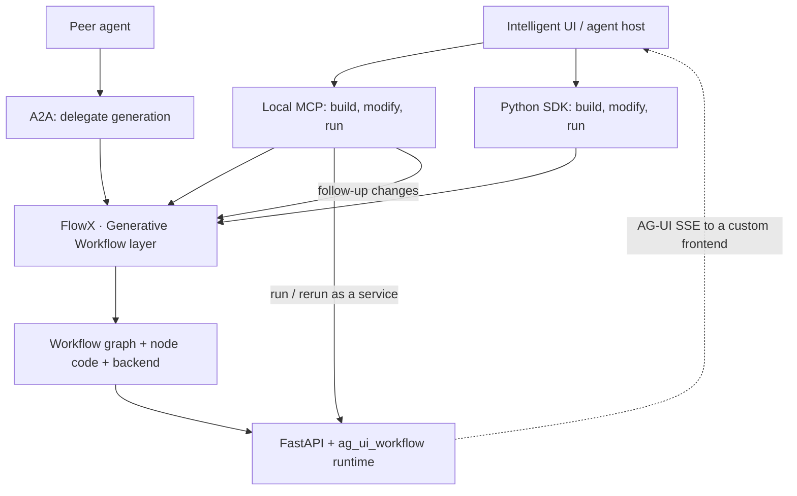
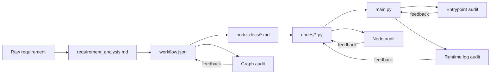

<a name="readme-top"></a>

<p align="center">
  
</p>

<h2 align="center">FlowX</h2>
<h3 align="center">Generate, run, and evolve AI agent workflows from natural language</h3>

<p align="center">
  <strong>English</strong> · <a href="README.zh-CN.md">简体中文</a>
</p>

<p align="center">
  
  
  
  
  <a href="https://github.com/AIpRoBuilder/FlowX/stargazers"></a>
  <a href="https://hub.xerj.org/contributors/xiechuxi"></a>
</p>

<p align="center">
  <a href="#quickstart">🚀 Quick Start</a> ·
  <a href="#key-features">✨ Key Features</a> ·
  <a href="#tool-surface">🧰 MCP Tools</a> ·
  <a href="#python-sdk">🐍 Python SDK</a> ·
  <a href="#a2a-server">🤝 A2A</a> ·
  <a href="#architecture">🏗️ Architecture</a> ·
  <a href="docs/DYNAMIC_WORKFLOW.md">📖 Docs</a> ·
  <a href="README.zh-CN.md">简体中文</a>
</p>

FlowX is an **MCP server, Python SDK, and A2A adapter that let AI agents build, run, and evolve workflows**. Describe a process in plain language; FlowX compiles it into a workflow graph (`workflow.json`), audited and tested per-node Python implementations, and a runnable FastAPI backend. The agent can then inspect the artifacts, start the service, feed step inputs, and evolve the workflow in the same conversation, so it becomes a reusable process instead of a one-off answer.

<p align="center"><strong>Describe → Generate → Inspect → Run → Evolve → Reuse</strong></p>

**Original upstream:** [AIpRoBuilder/FlowX](https://github.com/AIpRoBuilder/FlowX) ·
[Attribution notice](NOTICE) · [Source provenance and verification](docs/PROVENANCE.md).
FlowX remains Apache-2.0 licensed; compliant forks and reuse are welcome.

<a name="news"></a>
## 📣 News

- **[2026.10.28]** 🧩 **Expanded node engine.** Each business node now runs a generation → audit → test → bounded repair chain before it is published.
- **[2026.10.24]** ⚙️ **WorkflowEngine-native generation.** Graph, node, and entrypoint workflows are now `WorkflowEngine` subclasses.
- **[2026.10.22]** 🚀 **Interactive runtime.** `run_service` returns a connectable `base_url`; MCP adds `run_step` and `reset_session`.
- **[2026.10.20]** 🛠️ **Guided node repair.** A failed node test can be amended with user guidance before it is retried.
- **[2026.10.19]** 🔁 **Evolve API.** `evolve` / `evolve_workflow` can target the whole workflow, a single node, or let the engine decide.

<a name="why-flowx"></a>
## 🌟 Why FlowX?

FlowX is a **Generative Workflow layer** for AI agents: it turns intent into an executable process instead of a one-off chat answer. The process is stored as an explicit graph and code, so an agent can inspect it, run it, and change only the parts that need to change.

| Instead of… | FlowX gives you… |
| --- | --- |
| A one-off chat answer | A reusable workflow stored on disk under `workspace/workflows/<workflow_id>` |
| A hand-drawn, static flow | A graph and node code generated from intent, audited, tested, and editable |
| Re-prompting from scratch | Follow-up changes that rebuild only the affected nodes |
| A hosted black box | A local, Apache-2.0 engine usable from any MCP-capable client, the Python SDK, or A2A |

<p align="center">
  
</p>

*Illustrative walkthrough, not a live recording. Your existing agent remains the assistant; FlowX provides its workflow capability behind the conversation. Messages and per-node cards illustrate what the host UI can render, independent of transport. FlowX does not bundle this interface or automatically generate these card layouts. Generation and execution times are illustrative. See the [storyboard and rendering instructions](assets/README-demo.md).*

### Where FlowX fits

**Generative UI shapes the interaction. Generative Workflow shapes the execution.** FlowX focuses on the latter: the explicit process an agent can build, run, and change behind a chat, a task panel, or another intelligent interface.

| Layer | Responsibility |
| --- | --- |
| Intelligent UI / agent client | Capture intent and present progress, inputs, and results. The host application owns the interface. |
| **FlowX: Generative Workflow** | Turn intent into workflow artifacts; expose tools to inspect, execute, and evolve them. |
| Workflow runtime | Execute generated nodes in a FastAPI backend using [ag_ui_workflow](https://github.com/AIpRoBuilder/ag_ui_worflow); expose step events over AG-UI SSE. |

FlowX is model- and UI-agnostic. Connect an MCP-capable agent client, call the Python SDK, or delegate workflow generation over A2A. A custom frontend can consume the generated backend's events; rendering those events remains the frontend's responsibility. No dedicated integration with a particular model or intelligent UI is implied.

> [!NOTE]
> The primary interactive path is local stdio MCP. MCP and the Python SDK expose the same engine: build or modify `workflow.json` and requirements, nodes, the main entrypoint, or the whole workflow; then run it as a service and feed step inputs. The A2A adapter currently exposes non-streaming workflow building. FlowX is a workflow layer, not a hosted UI product.

<a name="key-features"></a>
## 🚀 Key Features

- 🧩 **Intent → executable workflow** — Generate a workflow graph, node documentation, Python node code, and a backend entry point.
- 🛡️ **Audited, tested, self-repairing nodes** — Each business node runs through generation, audit, test, and bounded repair; a node that still fails is not published.
- 🔁 **Conversational evolution** — Change the whole workflow or specific nodes; unchanged nodes are reused. SDK callers can guide a failed node's repair.
- 🚀 **Local execution loop** — Start and stop a built workflow through MCP or the SDK; feed step inputs and reset sessions through MCP.
- 🔌 **Three interfaces** — Local stdio MCP, Python SDK, and a non-streaming A2A adapter share the same core.
- 📦 **Reusable, versioned artifacts** — Workflows live on disk under `workspace/workflows/<workflow_id>` and can be reopened and evolved later.
- 🧠 **Model- and UI-agnostic** — Connect any MCP-capable client or your own frontend; FlowX does not bundle a UI.

<a name="table-of-contents"></a>
## 📑 Table of Contents

- [📣 News](#news)
- [🌟 Why FlowX?](#why-flowx)
- [🚀 Key Features](#key-features)
- [⚙️ Setup](#setup)
  - [Installation](#installation)
  - [Configure the environment](#configure-the-environment)
  - [Start the MCP server](#start-the-mcp-server)
  - [Register FlowX in an MCP client](#register-flowx-in-an-mcp-client)
- [⚡ Quick Start](#quickstart)
- [🧰 MCP Tool Surface](#tool-surface)
- [🐍 Python SDK](#python-sdk)
- [🤝 A2A Server](#a2a-server)
- [🏗️ Architecture](#architecture)
  - [Runtime topology](#runtime-topology)
  - [Repository layout](#repository-layout)
  - [Artifact flow](#artifact-flow)
- [🧪 Runtime Compatibility](#runtime-compatibility)
- [🙏 Acknowledgements](#acknowledgements)
- [🤝 Contributing](#contributing)
- [💬 Contact](#contact)
- [📜 License & Provenance](#license-provenance)
- [⭐ Star History](#star-history)

<a name="setup"></a>
## ⚙️ Setup

### Prerequisites

- **Python 3.10 or later.**
- An MCP-capable agent client for the local stdio path.
- An OpenAI-compatible LLM provider (DeepSeek is the default).

<a name="installation"></a>
### Installation

One installation includes the shared core, MCP adapter, Python SDK, and A2A adapter.

#### pip

```bash
# Create and activate a virtual environment
python3.10 -m venv .venv
source .venv/bin/activate

# Install FlowX and its runtime dependencies
python -m pip install --upgrade pip
python -m pip install -e .
```

<details>
<summary>Poetry, uv, or conda</summary>

```bash
# Poetry
poetry env use python3.10
poetry install

# uv
uv sync

# conda
conda env create -f environment.yml
conda activate flowx
```

</details>

<details>
<summary>Install with a local ag_ui_workflow checkout</summary>

The FlowX agent is vendored under `packages/core/flowx_core`. Only [ag_ui_workflow](https://github.com/AIpRoBuilder/ag_ui_worflow) remains an external workflow-runtime dependency. To use a local checkout instead of its Git dependency, install it first and then install FlowX without dependencies.

```bash
python3.10 -m venv .venv
source .venv/bin/activate
python -m pip install --upgrade pip
python -m pip install -e ../ag_ui_worflow --no-deps
python -m pip install -e . --no-deps
```

With Poetry or uv:

```bash
# Poetry
poetry env use python3.10
poetry install
poetry run pip install -e ../ag_ui_worflow --no-deps

# uv
uv venv --python 3.10
uv pip install --python .venv/bin/python -e ../ag_ui_worflow --no-deps
uv pip install --python .venv/bin/python -e . --no-deps
```

</details>

For source-checkout execution, FlowX automatically discovers each `packages/*` component. Set `FLOWX_EXTRA_PATHS` only when the external `ag_ui_workflow` source is not installed.

<a name="configure-the-environment"></a>
### Configure the environment

```bash
cp .env.example .env
```

Set at least `FLOWX_LLM_PROVIDER`, `FLOWX_LLM_MODEL`, `FLOWX_LLM_API_KEY`, and `FLOWX_DEFAULT_WORKSPACE`.

```dotenv
FLOWX_LLM_PROVIDER=deepseek
FLOWX_LLM_MODEL=deepseek-flash
FLOWX_LLM_API_KEY=
FLOWX_DEFAULT_WORKSPACE=./.flowx_workspaces
```

`FLOWX_CONFIG_ROOT` lets an installed `flowx-mcp` resolve a `.env` file outside the repository checkout. `FLOWX_EXTRA_PATHS` can point at a local [ag_ui_workflow](https://github.com/AIpRoBuilder/ag_ui_worflow) source when it is not installed into the current environment.

<a name="start-the-mcp-server"></a>
### Start the MCP server

```bash
# Default local stdio entry point
flowx-mcp

# Verbose logging
flowx-mcp --verbose

# Source-checkout entry point
python3.10 run_server.py
```

For interactive terminal use, prefix with `poetry run` or `uv run` if the environment is not activated. For MCP client configuration, use the absolute executable path and arguments described below; an MCP host may not inherit your shell's `PATH`.

<a name="register-flowx-in-an-mcp-client"></a>
### Register FlowX in an MCP client

```jsonc
{
  "mcpServers": {
    "flowx": {
      "command": "flowx-mcp",
      "env": {
        "FLOWX_LLM_PROVIDER": "deepseek",
        "FLOWX_LLM_MODEL": "deepseek-flash",
        "FLOWX_LLM_API_KEY": "<your key>",
        "FLOWX_DEFAULT_WORKSPACE": "/Users/user/Desktop/codes/flowx_workspaces"
      }
    }
  }
}
```

<a name="quickstart"></a>
## ⚡ Quick Start

The describe → generate → inspect → run → evolve loop works through any local MCP-capable agent client.

### 1. Describe a workflow

```text
Use flowx to build a workflow.

Build a workflow that accepts a support ticket, classifies its category,
assigns a priority, and drafts a reply. Name the reply node draft_reply.
Return the category, priority, and draft reply as structured output.
```

### 2. Build and inspect

The agent calls `build_workflow` (or `build_workflow_json`, `build_nodes`, and `build_main_entrypoint` one stage at a time) to create the graph, node implementations, and backend. Use `list_workflows`, `list_nodes`, and `get_workflow` to inspect workflow ids, node ids, and artifact locations. Exact step IDs come from the generated workflow—not from a fixed demo schema.

### 3. Run, evolve, and reuse

```text
Run the workflow as a service.

Update the draft_reply node: for urgent tickets, include an escalation note.
Then rerun the service.
```

`run_service` starts or restarts the generated service. `run_step` feeds one step's input to the running service and reports when the workflow pauses for more input; `reset_session` cancels a paused run. `evolve_workflow` changes the whole workflow (`target="workflow"`), one node (a step id or node id from `list_nodes`), or lets the engine decide.

This is the distinction: the agent does not only answer the ticket. It builds and evolves the process for handling the next one.

<a name="tool-surface"></a>
## 🧰 MCP Tool Surface

These MCP tools let the host agent operate the workflow layer from the same conversation. UI rendering is deliberately left to the host.

| Category | Tool | Purpose |
| --- | --- | --- |
| Build | `build_workflow_json` | Create (no `workflow_id`) or modify `workflow.json` together with its requirement analysis. |
| Build | `build_nodes` | Build a workflow's nodes, or amend specific nodes by step id; unchanged nodes are reused. |
| Build | `build_main_entrypoint` | Create or regenerate the main entrypoint from the latest nodes. |
| Build | `build_workflow` | Create or modify the whole workflow from a request and/or run logs; later stages follow earlier changes. |
| Build | `evolve_workflow` | Evolve an existing workflow (`target="workflow"`) or one node (step id or node id) with a change command; without `target` the engine decides. |
| Runtime | `run_service` | Run a built workflow as a service and return its `base_url`; calling it again reruns the service with the latest files. |
| Runtime | `run_step` | Feed one step's input to the running service; returns `awaiting` when the workflow pauses for more input. |
| Runtime | `reset_session` | Cancel a paused session so the next `run_step` starts a fresh run. |
| Runtime | `stop_service` | Stop a workflow's running service. |
| Inspection | `list_workflows` | List workflow ids with their node ids, versions and unresolved errors. |
| Inspection | `list_nodes` | List a workflow's nodes as step id, node id and version; use them as `evolve_workflow` targets. |
| Inspection | `get_workflow` | Locate a workflow's requirement, `workflow.json`, node versions and main entrypoint. |

<a name="python-sdk"></a>
## 🐍 Python SDK

Embed workflow building directly in a Python agent or the backend behind your own intelligent UI, without an MCP transport. A complete walkthrough is in [examples/sdk_quickstart.py](examples/sdk_quickstart.py).

```python
from flowx_sdk import FlowXClient

with FlowXClient(workspace="./workflows") as flowx:
    created = flowx.build_workflow_json(
        "Build a workflow that categorizes and prioritizes support tickets.",
    ).raise_for_failure()                                  # workflow.json + requirements
    workflow_id = created.workflow_id
    flowx.build_nodes(workflow_id).raise_for_failure()     # all nodes, or {step_id: amendment}
    flowx.build_main_entrypoint(workflow_id).raise_for_failure()
    flowx.build_workflow("Also return a summary.", workflow_id=workflow_id)  # whole engine
    print(flowx.run_service(workflow_id))                  # run / rerun as a service
```

Each build call returns an `AgentResult` with per-stage outcomes, unresolved errors, logs and artifact paths; stage failures are reported there rather than raised.

Pass `repair_input_callback=...` to `build_nodes`, `build_workflow`, or `evolve` to guide a node's amendment after its test fails. The callback receives a `NodeRepairInput` with the node step id, attempt number, pytest log and test result, and returns guidance to combine with the log, `"skip"` to skip the amendment, or `""` to use the log alone. A runnable walkthrough is in [examples/sdk_guided_repair.py](examples/sdk_guided_repair.py).

To change an existing workflow, choose what to evolve with `evolve(workflow_id, command, target=...)`. `list_nodes` returns each node's step id and node id to use as a target; without a `target` the engine decides what the command refers to. A runnable walkthrough is in [examples/sdk_evolve.py](examples/sdk_evolve.py).

For a direct, LLM-free smoke test of the expanded `DynamicWorkflowOrchestrator` engine, see [examples/dynamic_workflow_orchestrator.py](examples/dynamic_workflow_orchestrator.py). It exercises per-node generation/repair chains, finalizer IDs and an incremental business-graph update.

```python
from flowx_sdk import WORKFLOW_TARGET

nodes = flowx.list_nodes(workflow_id)   # [{"step_id": ..., "node_id": ..., "version": ...}]
flowx.evolve(workflow_id, "Add a language-detection step.", target=WORKFLOW_TARGET)  # the workflow
flowx.evolve(workflow_id, "Validate empty input.", target=nodes[0]["step_id"])       # one node (step id or node id)
flowx.evolve(workflow_id, "Also return a one-line summary.")                         # engine judges
```

<a name="a2a-server"></a>
## 🤝 A2A Server

Let another agent delegate workflow generation to FlowX through the non-streaming Agent2Agent endpoint:

```bash
flowx-a2a --host 127.0.0.1 --port 8001
```

It serves an A2A agent card at `/.well-known/agent-card.json` and JSON-RPC at `/a2a` (also `/`). Supported methods are `message/send`, `tasks/get`, and `tasks/cancel`. Send an A2A text message to build a workflow; add `metadata.workflowId` to modify an existing one. The task is `completed` when every stage succeeded and otherwise `failed`; either way it carries the result, including the generated artifact paths.

<a name="architecture"></a>
## 🏗️ Architecture

The Generative Workflow layer has one shared core and three agent-facing interfaces: `flowx_core` plans, generates, audits, and runs the generated workflows; `flowx_mcp`, `flowx_sdk`, and `flowx_a2a` make those capabilities available to different agent hosts. The generated runtime sits beneath that layer; the intelligent UI sits above it.



<a name="runtime-topology"></a>
### Runtime topology

<div align="center">
  
</div>

- `flowx_mcp.server` exposes the tool surface over stdio through FastMCP.
- `flowx_core.AgentBuilder` owns the LLM-backed generation workflows; `AgentWorkflowEngine` drives each request through the reformat, graph, node, and main-entrypoint stages.
- `flowx_core.DynamicWorkflowOrchestrator` expands each business node into generation, audit, test, and bounded repair steps, then publishes versioned artifacts.
- `flowx_sdk.FlowXClient` and `flowx_a2a` call the same agent core without routing through MCP.
- The generated `main.py` runs as a managed FastAPI subprocess per workflow.
- `run_service` starts or restarts the generated `main.py`; `run_step` and `reset_session` drive an interactive run over HTTP and AG-UI SSE.

<a name="repository-layout"></a>
### Repository layout

| Path | Import | Responsibility |
| --- | --- | --- |
| `packages/core` | `flowx_core` | Request engine, graph and node generation, audits, repair orchestration, and service supervision. |
| `packages/mcp` | `flowx_mcp` | Local stdio MCP server and tool surface. |
| `packages/sdk` | `flowx_sdk` | Python client for building, evolving, inspecting, and running workflows. |
| `packages/a2a` | `flowx_a2a` | Non-streaming A2A adapter. |
| `docs` | — | Dynamic-workflow, runtime-compatibility, and provenance details. |
| `tests` | — | Cross-package layout and provenance checks. |

<a name="artifact-flow"></a>
### Artifact flow

Workflow compilation is the mechanism behind the Generative Workflow layer. Planning and code generation turn intent into artifacts; audits provide feedback during generation and runtime checks. The artifact flow below is mirrored from [assets/architecture.mmd](assets/architecture.mmd).



<a name="runtime-compatibility"></a>
## 🧪 Runtime Compatibility

FlowX targets the request-scoped `ag_ui_workflow` API, verified against upstream revision `0319046` (2026-10-23), including the `StepMeta` step-metadata contract. Contract details for contributors are in [docs/RUNTIME.md](docs/RUNTIME.md).

<a name="acknowledgements"></a>
## 🙏 Acknowledgements

FlowX thanks [CGraph](https://github.com/ChunelFeng/CGraph) for providing the runtime DAG engine framework used in workflow execution.

<a name="contributing"></a>
## 🤝 Contributing

Issues and pull requests are welcome. If FlowX is useful to you, star the repo, share a workflow you generated, or open an issue describing an intent you want turned into a workflow.

When you redistribute or modify FlowX, keep the [LICENSE](LICENSE) and [NOTICE](NOTICE) attribution (see [docs/PROVENANCE.md](docs/PROVENANCE.md)).

<a name="contact"></a>
## 💬 Contact

Interested in building the Generative Workflow layer for AI Agents—or connecting it to an intelligent UI? Get in touch at [peterxcx@gmail.com](mailto:peterxcx@gmail.com).

WeChat QR code:


<a name="license-provenance"></a>
## 📜 License & Provenance

FlowX is licensed under the [Apache License 2.0](LICENSE). Redistribution and modification are permitted under its terms; keep the [NOTICE](NOTICE) attribution and the [source provenance](docs/PROVENANCE.md) record when redistributing FlowX source.

**Original upstream:** [AIpRoBuilder/FlowX](https://github.com/AIpRoBuilder/FlowX).

<a name="star-history"></a>
## ⭐ Star History

[](https://star-history.com/#AIpRoBuilder/FlowX&Date)

<p align="right">
  <a href="#readme-top">↑ Back to Top ↑</a>
</p>