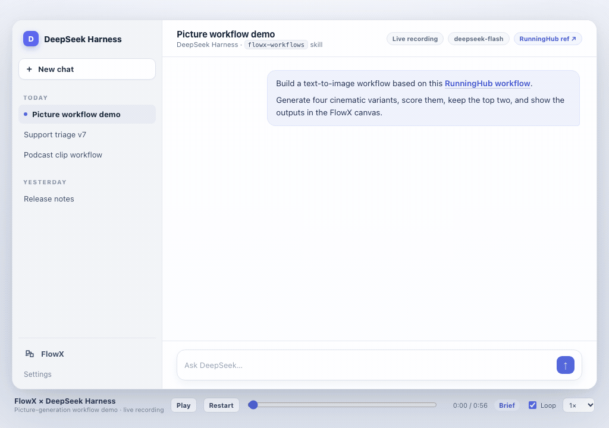
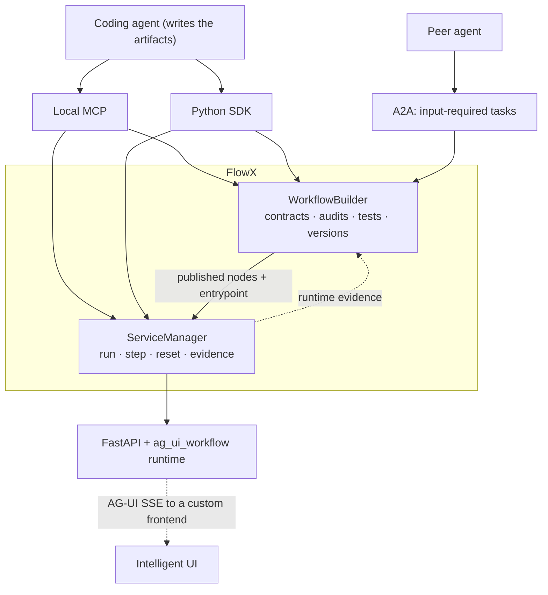
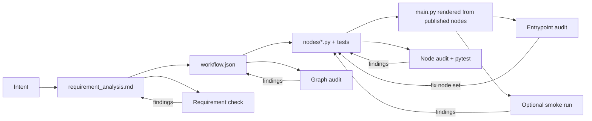

<a name="readme-top"></a>
<!-- Modified 2026-11-02: clarify SDK repair behavior and paused-result fields. -->
<!-- Modified 2026-11-03: document workflow-indexed background builds and review. -->
<!-- Modified 2026-11-03: document the background-only MCP build interface. -->
<!-- Modified 2026-11-03: document installation of the FlowX agent skill. -->
<!-- Modified 2026-11-03: add Hermes Agent skill installation instructions. -->
<!-- Modified 2026-11-04: update skill installation for its move to the repository root. -->
<!-- Modified 2026-11-04: document first-use setup and combined Hermes installation. -->
<!-- Modified 2026-11-04: streamline setup and quick-start guidance. -->
<!-- Modified 2026-11-05: install the complete skill including SDK scripts. -->
<!-- Modified 2026-11-06: document CLI answers for paused node-test repairs. -->
<!-- Modified 2026-11-09: link to the optional DeepSeek Harness plugin. -->
<!-- Modified 2026-11-10: clarify the requested read-only Harness viewer. -->
<!-- Modified 2026-11-11: document optional named workflow allocation. -->
<!-- Modified 2026-11-12: clarify Harness Web and Desktop plugin installation. -->
<!-- Modified 2026-11-16: announce media workflow support and the Harness media canvas. -->
<!-- Modified 2026-11-17: announce workflow service .env editing. -->
<!-- Modified 2026-11-20: add Discord community badge and invite link. -->
<!-- Modified 2026-11-22: FlowX no longer calls an LLM; document the agent-driven workflow builder and service manager. -->

<p align="center">
  
</p>

<h2 align="center">FlowX</h2>
<h3 align="center">Your coding agent writes the workflow; FlowX audits, tests, versions, and runs it</h3>

<p align="center">
  <strong>English</strong> · <a href="README.zh-CN.md">简体中文</a>
</p>

<p align="center">
  
  
  
  
  <a href="https://discord.com/invite/KHnDtNqxp"></a>
  <a href="https://github.com/AIpRoBuilder/FlowX/stargazers"></a>
  <a href="https://hub.xerj.org/contributors/xiechuxi"></a>
</p>

<p align="center">
  <a href="#setup">⚙️ Setup</a> ·
  <a href="#quickstart">🚀 Quick Start</a> ·
  <a href="#key-features">✨ Key Features</a> ·
  <a href="#tool-surface">🧰 MCP Tools</a> ·
  <a href="#python-sdk">🐍 Python SDK</a> ·
  <a href="#a2a-server">🤝 A2A</a> ·
  <a href="#architecture">🏗️ Architecture</a> ·
  <a href="docs/DYNAMIC_WORKFLOW.md">📖 Docs</a> ·
  <a href="https://discord.com/invite/KHnDtNqxp">💬 Discord</a> ·
  <a href="README.zh-CN.md">简体中文</a>
</p>

FlowX lets AI agents **build, run, and evolve workflows** through MCP, a Python SDK, or A2A. FlowX does not call a model: it hands your coding agent a *contract* for each artifact (requirement, workflow graph, one task per node), audits and tests what comes back, publishes versioned nodes, renders a FastAPI backend, and runs it.

<p align="center"><strong>Describe → Generate → Inspect → Run → Evolve → Reuse</strong></p>

**Original upstream:** [AIpRoBuilder/FlowX](https://github.com/AIpRoBuilder/FlowX) ·
[Attribution notice](NOTICE) · [Source provenance and verification](docs/PROVENANCE.md).
FlowX remains Apache-2.0 licensed; compliant forks and reuse are welcome.

<a name="news"></a>
<details>
<summary>📣 News</summary>

- **[2026.11.22]** 🧭 **Agent-driven builds; no LLM inside FlowX.** FlowX is now two things: a **workflow builder** and a **service manager**. The builder keeps the `ag_ui_workflow` pipeline (requirement → graph → one gate per node → entrypoint) but its steps wait for *your agent*: each gate returns a contract packet, accepts the artifacts, runs the auditors and the node's pytest, and either publishes a version or returns structured findings for a repair task. Agents see every stage and node status through `get_build_state` and an append-only journal. The old `start_*`/`get_build_status` MCP tools, `evolve`/`build_*` SDK methods, repair gating and the LLM provider/API-key settings are gone. See [docs/DYNAMIC_WORKFLOW.md](docs/DYNAMIC_WORKFLOW.md).
- **[2026.11.19]** 🎛️ **Hermes Agent plugin.** The new [Hermes plugin](plugins/hermes-flowx/README.md) adds a read-only FlowX dashboard tab with a draggable plan graph, run journal cards, bounded media previews, and a workflow file browser, plus five agent tools. It never builds, runs, or mutates workflows; `canvas_layout.json` is the only file it writes. Install it separately with `hermes plugins install AIpRoBuilder/FlowX/plugins/hermes-flowx --enable`.
- **[2026.11.16]** 🖼️ **Media workflow support.** Generated nodes can return `prompt`, `image`, and `video` cards in addition to structured text. The new `flowx_core.media` toolkit adds provider image/video helpers, Pillow resize and crop, FFmpeg trim and resize, optional headless Blender (`FLOWX_ENABLE_BLENDER=1`), and `FLOWX_MEDIA_DRY_RUN=1` for zero-cost node tests. Media outputs and step cards are journaled under `workflows/<workflow_id>/runs/`. Provider calls can be billable, and generated code and tests are not sandboxed.
- **[2026.11.16]** 🎛️ **DeepSeek Harness plugin update.** The workflow canvas now previews each node's `prompt`, `image`, and `video` cards, with run history (**Sync outputs**), stale-revision badges, zoom/wide canvas, drag-to-arrange layout saved per workflow, and a lightbox for full-size previews. Media is delivered through an owner-only `/api/flowx/media` route using authenticated HTTP `Range` responses. Each workflow also has an **Edit .env** panel that shows and edits its `service_<id>/.env` file for service-specific provider, media, and tool configuration. See the [plugin README](plugins/deepseek-harness-flowx/README.md).
- **[2026.11.10]** 🔑 **Skill and plugin update.** The DeepSeek Harness plugin no longer asks for a skill directory; the FlowX skill scripts reuse the plugin's saved Python and workspace.
- **[2026.10.28]** 🧩 **Expanded node engine.** Each business node now runs a generation → audit → test → bounded repair chain before it is published.
- **[2026.10.24]** ⚙️ **WorkflowEngine-native generation.** Graph, node, and entrypoint workflows are now `WorkflowEngine` subclasses.
- **[2026.10.22]** 🚀 **Interactive runtime.** `run_service` returns a connectable `base_url`; MCP adds `run_step` and `reset_session`.
- **[2026.10.20]** 🛠️ **Guided node repair.** A failed node test can be amended with user guidance before it is retried.
- **[2026.10.19]** 🔁 **Evolve API.** SDK `evolve` and MCP workflow evolution can target the whole workflow, a single node, or let the engine decide.

</details>

<a name="why-flowx"></a>
## 🌟 Why FlowX?

Turn an intent into an editable, reusable process instead of a one-off answer. Change the workflow later without rebuilding unchanged nodes.

<p align="center">
  
</p>

*Live recording of a FlowX picture-generation workflow in DeepSeek Harness. See the [storyboard](assets/README-picture-demo.md) or [open the interactive demo](assets/picture-workflow-demo.html).*

<a name="key-features"></a>
## 🚀 Key Features

- 🧩 **Contracts, not prompts:** each build step returns a packet with the contract, rules, context, and artifact slots; the host agent writes the code.
- 🛡️ **Audit and test every node** with the same auditors and pytest as before; failing nodes are not published and come back as findings with remediation.
- 👀 **Stay aware:** `get_build_state` reports stages, per-node status, open tasks, and the next action; `get_build_events` is the journal.
- 🔁 **Evolve** the whole workflow or one node (`target`), reusing nodes whose inputs did not change.
- 🚀 **Run locally** through MCP or the SDK; the service manager drives steps, resets sessions, and returns run evidence for the next fix.
- 🔌 **Choose an interface:** local stdio MCP, Python SDK, or non-streaming A2A (a build is an `input-required` task).
- 📦 **Reuse artifacts** stored under `workspace/workflows/<workflow_id>`.
- 🧠 **Bring your own agent and UI:** the optional [DeepSeek Harness plugin](plugins/deepseek-harness-flowx/README.md) provides a read-only workflow viewer for Web and Desktop, installed separately in each profile; use the separate FlowX skill to create, evolve, and run workflows.
- 🎛️ **Inspect from Hermes Agent:** the optional [Hermes plugin](plugins/hermes-flowx/README.md) adds a read-only FlowX dashboard tab and five agent tools; install it separately with `hermes plugins install AIpRoBuilder/FlowX/plugins/hermes-flowx --enable`.

<a name="setup"></a>
## ⚙️ Setup

### Prerequisites

- **Python 3.10 or later.**
- Git, to obtain FlowX and its workflow runtime dependency.
- An MCP-capable coding agent (or your own Python or A2A agent) to write the artifacts FlowX asks for.

<a name="installation"></a>
### Installation

Clone FlowX and install the core, MCP server, SDK, and A2A adapter:

#### pip

```bash
git clone https://github.com/AIpRoBuilder/FlowX.git
cd FlowX

# Create and activate a virtual environment
python3.10 -m venv .venv
source .venv/bin/activate

# Install FlowX and its runtime dependencies
python -m pip install --upgrade pip
python -m pip install -e .
```

<details>
<summary>Poetry, uv, or conda</summary>

```bash
# Poetry
poetry env use python3.10
poetry install

# uv
uv sync

# conda
conda env create -f environment.yml
conda activate flowx
```

</details>

<details>
<summary>Install with a local ag_ui_workflow checkout</summary>

To replace the Git-installed [ag_ui_workflow](https://github.com/AIpRoBuilder/ag_ui_worflow) runtime with a local checkout, install FlowX and its dependencies first, then install the local runtime without dependencies:

```bash
python3.10 -m venv .venv
source .venv/bin/activate
python -m pip install --upgrade pip
python -m pip install -e .
python -m pip install -e ../ag_ui_worflow --no-deps
```

With Poetry or uv:

```bash
# Poetry
poetry env use python3.10
poetry install
poetry run pip install -e ../ag_ui_worflow --no-deps

# uv
uv sync
uv pip install --python .venv/bin/python -e ../ag_ui_worflow --no-deps
```

</details>

For source-checkout execution, FlowX automatically discovers each `packages/*` component. Set `FLOWX_EXTRA_PATHS` only when the external `ag_ui_workflow` source is not installed.

<a name="configure-the-environment"></a>
### Configure the environment

```bash
cp .env.example .env
```

Edit `.env` and set the workspace:

```dotenv
FLOWX_DEFAULT_WORKSPACE=./.flowx_workspaces
```

FlowX needs no model key. Provider and media variables (for example `FLOWX_IMAGE_API_KEY`) are only for the workflows you generate; put them in the process environment or in the workflow service's own `.env`.

`FLOWX_CONFIG_ROOT` lets an installed `flowx-mcp` resolve a `.env` file outside the repository checkout. `FLOWX_EXTRA_PATHS` can point at a local [ag_ui_workflow](https://github.com/AIpRoBuilder/ag_ui_worflow) source when it is not installed into the current environment.

The SDK and A2A server read process environment variables; they do not automatically load this `.env` file. Export the settings or load the file in your application before creating a client. For example, from the checkout root in macOS/Linux:

```bash
set -a; source .env; set +a
```

<a name="start-the-mcp-server"></a>
### Start the MCP server

```bash
# Default local stdio entry point
flowx-mcp

# Verbose logging
flowx-mcp --verbose

# Source-checkout entry point
python3.10 run_server.py
```

Use `poetry run` or `uv run` if the environment is not activated. An MCP host normally starts the server itself; the command above is for checking the entry point.

<a name="register-flowx-in-an-mcp-client"></a>
### Register FlowX in an MCP client

Replace the executable with the absolute path to your virtual environment's `flowx-mcp`, and set your workspace. MCP hosts may not inherit your shell's `PATH`.

```jsonc
{
  "mcpServers": {
    "flowx": {
      "command": "/absolute/path/to/your/venv/bin/flowx-mcp",
      "env": {
        "FLOWX_DEFAULT_WORKSPACE": "/absolute/path/to/flowx_workspaces"
      }
    }
  }
}
```

Store any workflow credentials according to your MCP client's security guidance; avoid committing them to a repository.

<a name="install-the-flowx-agent-skill"></a>
### Install the FlowX agent skill

<details>
<summary>Optional: install the skill for VS Code or Hermes Agent</summary>

The [FlowX workflow skill](skills/flowx-workflows/SKILL.md) guides a compatible
coding agent through building, inspecting, repairing, running, and evolving
workflows. Install it in a skill directory before using it.

To make it available in **a project** (including this one), run the following
from the root of a FlowX source checkout, replacing the example path with the
destination project's absolute path:

```bash
TARGET_PROJECT=/absolute/path/to/your/project
mkdir -p "$TARGET_PROJECT/.github/skills/flowx-workflows"
cp -R skills/flowx-workflows/. "$TARGET_PROJECT/.github/skills/flowx-workflows/"
```

Alternatively, install it for your user account in VS Code from the FlowX
source checkout:

```bash
mkdir -p ~/.copilot/skills/flowx-workflows
cp -R skills/flowx-workflows/. ~/.copilot/skills/flowx-workflows/
```

These commands overwrite matching files in the destination; review or back
up local changes first. Other agent hosts may use different skill directories;
check their documentation. When redistributing the skill, retain its attribution
and the applicable FlowX [LICENSE](LICENSE) and [NOTICE](NOTICE).

Open the target workspace in a skill-capable agent and ask it to use FlowX, or
invoke `/flowx-workflows` in a host that supports skill slash commands. Reload
the workspace if the skill is not discovered. Installing the skill copies its
instructions and scripts, not the SDK; on first use, the agent can install FlowX in an appropriate
Python environment if it is missing. Registering the
MCP server is a separate step. See [installation](#installation),
[environment](#configure-the-environment), and
[MCP registration](#register-flowx-in-an-mcp-client). A pip install does not
automatically install the agent skill.

#### Hermes Agent

With [Hermes Agent](https://hermes-agent.nousresearch.com/docs/user-guide/features/skills)
installed, install this skill from the public GitHub repository:

```bash
hermes skills install AIpRoBuilder/FlowX/skills/flowx-workflows
hermes skills list
```

In a Hermes chat, the equivalent is
`/skills install AIpRoBuilder/FlowX/skills/flowx-workflows`. Review the skill
and approve the installation when prompted; then start a new session or
refresh the skills and invoke `/flowx-workflows`. GitHub installation requires
the skill to have been committed and pushed to the repository's default branch;
it cannot install unpublished local changes.

To install both FlowX and the skill in one explicit operation on macOS or Linux,
run the following with Git, Hermes, and Python 3.10+ available. It creates a
dedicated virtual environment and refuses to reuse an existing path:

```bash
python3 -c 'import sys; assert sys.version_info >= (3, 10), "Python 3.10+ required"' && \
  test ! -e "$HOME/.flowx/venv" && \
  test ! -L "$HOME/.flowx/venv" && \
  python3 -m venv "$HOME/.flowx/venv" && \
  "$HOME/.flowx/venv/bin/python" -m pip install 'git+https://github.com/AIpRoBuilder/FlowX.git' && \
  hermes skills install AIpRoBuilder/FlowX/skills/flowx-workflows
```

Review and approve the Hermes prompt, then check its output. If a step fails or
the installation is declined, the environment may remain; inspect it before
retrying. The command does not register MCP or configure credentials. For MCP
registration use `$HOME/.flowx/venv/bin/flowx-mcp` as the executable; for SDK
code use `$HOME/.flowx/venv/bin/python`.

To install the current local checkout into the default Hermes profile instead,
run this from the FlowX repository root (back up any existing destination file
first):

```bash
mkdir -p ~/.hermes/skills/flowx-workflows
cp -R skills/flowx-workflows/. ~/.hermes/skills/flowx-workflows/
```

For a named profile or a custom Hermes home, use that profile's skills directory
instead. Copying manually does not use Hermes's hub installation or update
tracking. The skill is separate from the FlowX MCP server and its configuration.

</details>

<a name="quickstart"></a>
## ⚡ Quick Start

After [setup](#setup), ask your MCP-capable coding agent:

### 1. Describe a workflow

```text
Use flowx to build a workflow.

Build a workflow that accepts a support ticket, classifies its category,
assigns a priority, and drafts a reply. Name the reply node draft_reply.
Return the category, priority, and draft reply as structured output.
```

### 2. The agent builds with FlowX

1. `create_workflow(name="Ticket Triage")` allocates the folder and `workflow_id` (a safe single folder name that cannot overwrite an existing path).
2. `begin_build(workflow_id, intent)` opens a revision and returns `next_tasks`: contract packets with `contract` (instructions, rules, schema), `context`, `meta`, and `submit.slots`.
3. The agent writes each artifact and calls `submit_task(workflow_id, task_id, artifacts)`: first the `requirement`, then the `graph`, then one task per node (`code` and `test`). Independent nodes are open at the same time.
4. A rejection returns `findings` (`rule_id`, `message`, `line`, `remediation`), the node's test result, and a repair task (`attempt + 1`). The agent fixes exactly those findings; after `max_attempts` the node is `failed` and its descendants `blocked`.
5. `get_build_state` shows stages, per-node status, `next_action`, and unresolved `errors`; `get_build_events(since=seq)` reads the journal. When `status` is `completed`, every node was audited, tested, and published, and the entrypoint was rendered and audited.

Build state lives in the MCP server process and in `build/events.jsonl`; after a restart, call `begin_build` again: published nodes are reused, so only unfinished work is requested. Submitted node tests run locally under pytest and a smoke test or service run executes generated code; review it before running.

### 3. Run, evolve, and reuse

```text
Run the workflow as a service.

Update the draft_reply node: for urgent tickets, include an escalation note.
Then rerun the service.
```

`run_service` starts or restarts the generated service and waits until it answers. `run_step` feeds one step's input and reports when the workflow pauses for more input; `reset_session` cancels a paused run; `get_evidence` returns the latest run journal and service log tail. To change a workflow, `begin_build(workflow_id, intent=<change>, target=...)` with `"workflow"` (redo requirement and graph) or a node name or `node_id` from `list_nodes`; descendants whose inputs changed are asked again and everything else is reused.

<a name="tool-surface"></a>
## 🧰 MCP Tool Surface

These MCP tools let the host agent operate both FlowX entities from the same conversation. UI rendering is deliberately left to the host.

| Entity | Tool | Purpose |
| --- | --- | --- |
| Builder | `create_workflow(name=None, brief='')` | Allocate an empty workflow, optionally naming its folder and `workflow_id`. |
| Builder | `begin_build(workflow_id, intent, target=None, stages=None, runtime_evidence=None, fastapi_port=None, fastapi_host=None, smoke_test=False)` | Open a build revision; returns the state and the first contract tasks. |
| Builder | `get_build_state(workflow_id)` | Stages, node statuses, open task summaries, `next_action`, and unresolved errors. |
| Builder | `get_tasks(workflow_id, compact=False)` | Re-read the open contract tasks in full. |
| Builder | `submit_task(workflow_id, task_id, artifacts)` | Submit one task's artifacts; accepted ones are published, rejected ones return findings and a repair task. |
| Builder | `get_build_events(workflow_id, since=0, limit=200)` | The build journal after a sequence number. |
| Builder | `reopen_stage(workflow_id, stage, step_id=None, reason='')` | Redo the requirement (with graph), the graph, one node, or the entrypoint in a new revision. |
| Builder | `abort_build(workflow_id, reason='')` | Cancel the open revision; published versions are kept. |
| Service | `run_service`, `stop_service`, `service_status` | Start (or replace), stop, and inspect a workflow's service. |
| Service | `run_step`, `reset_session` | Feed one step's input to the running service; cancel a paused session. |
| Service | `list_runs`, `get_run`, `get_evidence` | Read the run journal and collect evidence for the next fix. |
| Inspection | `list_workflows`, `list_nodes`, `get_workflow`, `describe_workflow` | Workflow ids, versions and errors; step ids and node ids; artifact locations; step descriptions, input formats and input modes. |

<a name="python-sdk"></a>
## 🐍 Python SDK

Embed workflow building directly in a Python agent or the backend behind your own intelligent UI, without an MCP transport. `FlowXClient` exposes the same protocol as the MCP tools; `build()` drives a build to its end by answering every task with a function you provide, which is where your model or editor plugs in. A complete walkthrough is in [examples/sdk_quickstart.py](examples/sdk_quickstart.py).

```python
from flowx_sdk import FlowXClient

def solve(task: dict) -> dict:
    # task["contract"], task["context"], task["meta"], task["submit"]["slots"] say what to write.
    # Return {slot: text}: {"requirement": ...}, {"graph": ...} or {"code": ..., "test": ...}.
    return my_agent.write(task)

with FlowXClient(workspace="./workflows") as flowx:
    workflow_id = flowx.create_workflow("ticket-triage")
    state = flowx.build(workflow_id, "Categorize and prioritize support tickets.", solve)
    assert state["status"] == "completed", state["errors"]
    print(flowx.run_service(workflow_id))                  # run as a service
    input("Press Enter to stop the service... ")
```

Keep the client open while using the service; exiting the `with` block stops services it started and aborts open builds (published versions stay).

Before running a built workflow, `flowx.describe_workflow(workflow_id)` returns the workflow purpose and each step's description, `inputs_format`, `input_mode`, and `input_example`. Use it to decide whether a step takes a string, JSON object, or file path.

For finer control use the protocol directly: `begin_build`, `get_tasks`, `submit_task` (the result has `accepted`, `findings`, `test`, `next_tasks`, and `state`), `get_build_state`, `get_build_events`, `reopen_stage`, and `abort_build`. A runnable repair walkthrough is in [examples/sdk_guided_repair.py](examples/sdk_guided_repair.py).

### Drive the builder from a terminal

Agents without MCP can use the skill's build script, which keeps one client alive and speaks the same protocol as JSON lines. Run it from the repository root:

```bash
python skills/flowx-workflows/scripts/build.py --workspace "$WS"
```

It prints `{"event":"ready"}`, then answers each stdin line with one response line:

```json
{"op":"begin_build","workflow_id":"ticket-triage","intent":"Categorize and prioritize support tickets."}
{"op":"submit_task","workflow_id":"ticket-triage","task_id":"requirement:requirement:r1:a1","artifacts":{"requirement":{"file":"/tmp/requirement.md"}}}
```

Artifact values may be `{"file": path}` to read text from a file. Keep the process running for the whole build; `python build.py --help` lists every command. See the [skill instructions](skills/flowx-workflows/SKILL.md) and [builder documentation](docs/DYNAMIC_WORKFLOW.md).

To change an existing workflow, `begin_build(workflow_id, intent, target=...)` with `"workflow"` or a step id or node id from `list_nodes`; unchanged nodes are reused. A runnable walkthrough is in [examples/sdk_evolve.py](examples/sdk_evolve.py).

<a name="a2a-server"></a>
## 🤝 A2A Server

Let another agent build workflows with FlowX through the non-streaming Agent2Agent endpoint:

```bash
flowx-a2a --host 127.0.0.1 --port 8001
```

It serves an A2A agent card at `/.well-known/agent-card.json` and JSON-RPC at `/a2a` (also `/`). Supported methods are `message/send`, `tasks/get`, and `tasks/cancel`. A build is an A2A task: send a text message to start one (`metadata.workflowId` modifies an existing workflow, `metadata.target` picks `workflow` or a node). While contract tasks are open the task is `input-required` and its status message carries them as data parts; answer with a message on the same `taskId` whose data part is `{"task_id": ..., "artifacts": {...}}` (or `{"submissions": [...]}`). The task is `completed` when the build completed, `failed` when it failed, and `canceled` after `tasks/cancel`; a completed task carries the artifact locations.

<a name="architecture"></a>
## 🏗️ Architecture

FlowX is two entities behind three agent-facing interfaces. `flowx_core.builder` (**WorkflowBuilder**) sends the host agent contracts, verifies what it returns with the auditors and pytest, publishes versions, and renders the service; `flowx_core.service` (**ServiceManager**) runs and drives the result. `flowx_mcp`, `flowx_sdk`, and `flowx_a2a` expose both to different agent hosts. The generated runtime sits beneath; the intelligent UI sits above.



<a name="repository-layout"></a>
### Repository layout

| Path | Import | Responsibility |
| --- | --- | --- |
| `packages/core` | `flowx_core` | `builder` (contracts, gates, auditors' findings, versions, entrypoint rendering), `service` (service manager), auditors, and the native engine helpers. |
| `packages/mcp` | `flowx_mcp` | Local stdio MCP server and tool surface. |
| `packages/sdk` | `flowx_sdk` | Python client for building, inspecting, and running workflows. |
| `packages/a2a` | `flowx_a2a` | Non-streaming A2A adapter. |
| `docs` | — | Builder protocol, runtime-compatibility, and provenance details. |
| `tests` | — | Cross-package layout, skill, and provenance checks. |

<a name="artifact-flow"></a>
### Artifact flow

The agent writes the artifacts; FlowX gates each one. The flow below is mirrored from [assets/architecture.mmd](assets/architecture.mmd).



<a name="runtime-compatibility"></a>
## 🧪 Runtime Compatibility

FlowX targets the request-scoped `ag_ui_workflow` API, verified against upstream revision `0319046` (2026-10-23), including the `StepMeta` step-metadata contract. Contract details for contributors are in [docs/RUNTIME.md](docs/RUNTIME.md).

<a name="acknowledgements"></a>
## 🙏 Acknowledgements

FlowX thanks [CGraph](https://github.com/ChunelFeng/CGraph) for providing the runtime DAG engine framework used in workflow execution.

<a name="contributing"></a>
## 🤝 Contributing

Issues and pull requests are welcome. If FlowX is useful to you, star the repo, share a workflow you generated, or open an issue describing an intent you want turned into a workflow.

When you redistribute or modify FlowX, keep the [LICENSE](LICENSE) and [NOTICE](NOTICE) attribution (see [docs/PROVENANCE.md](docs/PROVENANCE.md)).

<a name="contact"></a>
## 💬 Contact

Interested in building the Generative Workflow layer for AI Agents—or connecting it to an intelligent UI? Get in touch at [peterxcx@gmail.com](mailto:peterxcx@gmail.com).

WeChat QR code:


<a name="license-provenance"></a>
## 📜 License & Provenance

FlowX is licensed under the [Apache License 2.0](LICENSE). Redistribution and modification are permitted under its terms; keep the [NOTICE](NOTICE) attribution and the [source provenance](docs/PROVENANCE.md) record when redistributing FlowX source.

**Original upstream:** [AIpRoBuilder/FlowX](https://github.com/AIpRoBuilder/FlowX).

<a name="star-history"></a>
## ⭐ Star History

[](https://star-history.com/#AIpRoBuilder/FlowX&Date)

<p align="right">
  <a href="#readme-top">↑ Back to Top ↑</a>
</p>