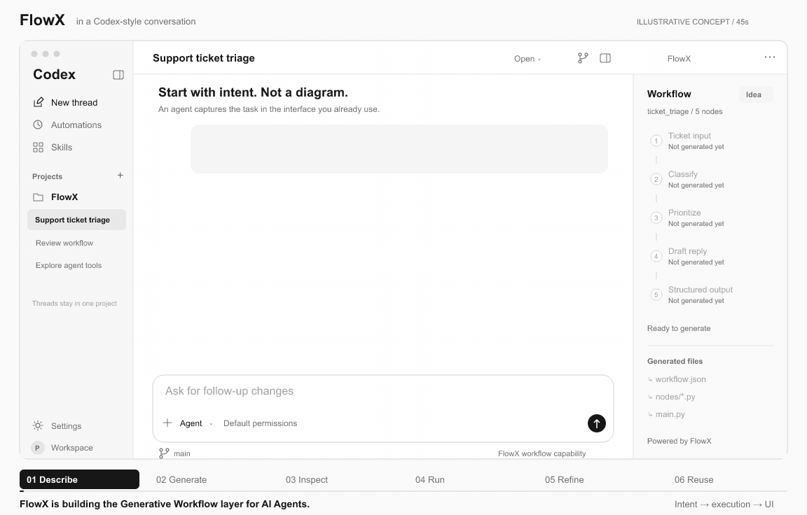
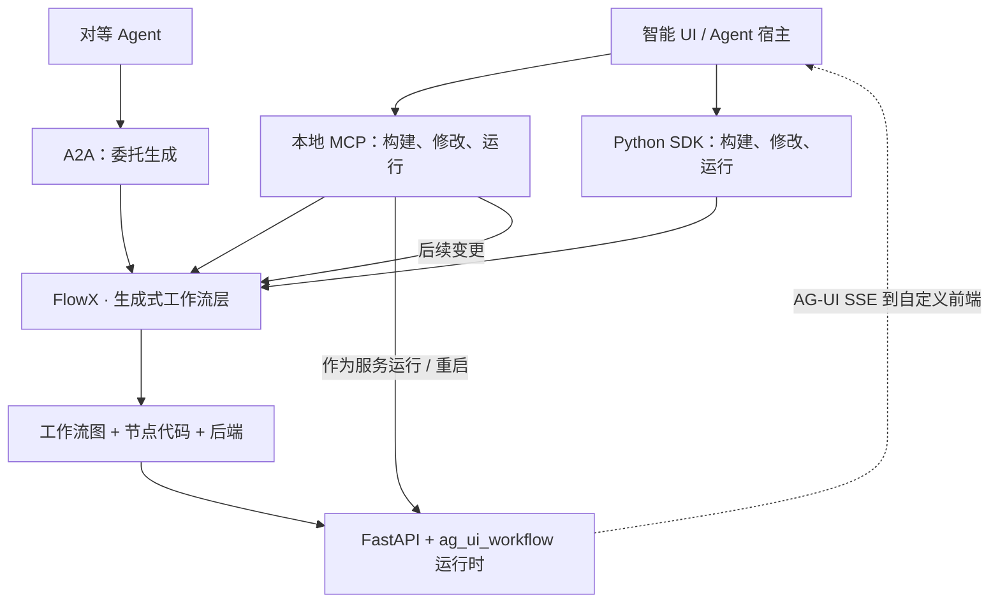
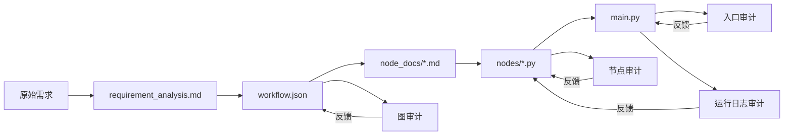

<a name="readme-top"></a>
<!-- Modified 2026-11-03: document workflow-indexed background builds and review. -->
<!-- Modified 2026-11-02: clarify SDK repair behavior and paused-result fields. -->
<!-- Modified 2026-11-03: document the background-only MCP build interface. -->
<!-- Modified 2026-11-03: document installation of the FlowX agent skill. -->
<!-- Modified 2026-11-03: add Hermes Agent skill installation instructions. -->
<!-- Modified 2026-11-04: update skill installation for its move to the repository root. -->
<!-- Modified 2026-11-04: document first-use setup and combined Hermes installation. -->
<!-- Modified 2026-11-04: streamline setup and quick-start guidance. -->

<p align="center">
  
</p>

<h2 align="center">FlowX</h2>
<h3 align="center">用自然语言生成、运行和演进 AI Agent 工作流</h3>

<p align="center">
  <a href="README.md">English</a> · <strong>简体中文</strong>
</p>

<p align="center">
  
  
  
  
  <a href="https://github.com/AIpRoBuilder/FlowX/stargazers"></a>
  <a href="https://hub.xerj.org/contributors/xiechuxi"></a>
</p>

<p align="center">
  <a href="#setup">⚙️ 安装配置</a> ·
  <a href="#quickstart">🚀 快速开始</a> ·
  <a href="#key-features">✨ 核心特性</a> ·
  <a href="#tool-surface">🧰 MCP 工具</a> ·
  <a href="#python-sdk">🐍 Python SDK</a> ·
  <a href="#a2a-server">🤝 A2A</a> ·
  <a href="#architecture">🏗️ 架构</a> ·
  <a href="docs/DYNAMIC_WORKFLOW.md">📖 文档</a> ·
  <a href="README.md">English</a>
</p>

FlowX 通过 MCP、Python SDK 或 A2A 让 AI Agent **构建、运行和演进工作流**。描述流程后，FlowX 会生成工作流图、经过审计和测试的 Python 节点及 FastAPI 后端。

<p align="center"><strong>描述 → 生成 → 检查 → 运行 → 演进 → 复用</strong></p>

**原始上游：** [AIpRoBuilder/FlowX](https://github.com/AIpRoBuilder/FlowX) ·
[署名说明](NOTICE) · [源码来源与验证](docs/PROVENANCE.md)。
FlowX 仍采用 Apache-2.0 许可证；欢迎符合许可证要求的 Fork 与复用。

<a name="news"></a>
<details>
<summary>📣 更新动态</summary>

- **[2026.10.28]** 🧩 **扩展节点引擎。** 每个业务节点在发布前都会执行“生成 → 审计 → 测试 → 有界修复”链路。
- **[2026.10.24]** ⚙️ **原生 WorkflowEngine 生成。** 图、节点和入口生成工作流现在都是 `WorkflowEngine` 的子类。
- **[2026.10.22]** 🚀 **交互式运行时。** `run_service` 返回可连接的 `base_url`；MCP 新增 `run_step` 与 `reset_session`。
- **[2026.10.20]** 🛠️ **引导式节点修复。** 节点测试失败后，可以结合用户指导进行修正并重试。
- **[2026.10.19]** 🔁 **演进 API。** SDK 的 `evolve` 和 MCP 工作流演进能力可以作用于整个工作流、单个节点，或由引擎自行判断。

</details>

<a name="why-flowx"></a>
## 🌟 为什么选择 FlowX？

将意图转换为可编辑、可复用的流程，而不是一次性回答。后续修改工作流时，无需重建未变化的节点。

<p align="center">
  
</p>

*示意演示，并非真实录屏。界面、卡片和耗时均为示意；FlowX 不捆绑该界面。参见[分镜说明](assets/README-demo.md)。*

<a name="key-features"></a>
## 🚀 核心特性

- 🧩 **生成**工作流图、节点文档、Python 代码和后端。
- 🛡️ **审计和测试**每个节点，并进行有界修复；失败的节点不会发布。
- 🔁 **演进**整个工作流或指定节点，复用未变化的节点。
- 🚀 **本地运行**工作流；MCP 还支持步骤输入和会话重置。
- 🔌 **选择接口：**本地 stdio MCP、Python SDK 或非流式 A2A。
- 📦 **复用产物：**工作流保存在 `workspace/workflows/<workflow_id>` 下。
- 🧠 **自选模型和 UI：**FlowX 不捆绑前端。

<a name="setup"></a>
## ⚙️ 安装与配置

### 前置要求

- **Python 3.10 或更高版本。**
- Git，用于获取 FlowX 及其工作流运行时依赖。
- 用于本地 stdio 路径的支持 MCP 的 Agent 客户端。
- 兼容 OpenAI API 的 LLM 提供商（默认使用 DeepSeek）。

<a name="installation"></a>
### 安装

克隆 FlowX 并安装核心、MCP 服务器、SDK 和 A2A 适配器：

#### pip

```bash
git clone https://github.com/AIpRoBuilder/FlowX.git
cd FlowX

# 创建并激活虚拟环境
python3.10 -m venv .venv
source .venv/bin/activate

# 安装 FlowX 及其运行时依赖
python -m pip install --upgrade pip
python -m pip install -e .
```

<details>
<summary>Poetry、uv 或 conda</summary>

```bash
# Poetry
poetry env use python3.10
poetry install

# uv
uv sync

# conda
conda env create -f environment.yml
conda activate flowx
```

</details>

<details>
<summary>使用本地 ag_ui_workflow 代码检出安装</summary>

如需用本地 [ag_ui_workflow](https://github.com/AIpRoBuilder/ag_ui_worflow) 源码替换 Git 安装的运行时，请先安装 FlowX 及其依赖，再以无依赖方式安装本地运行时：

```bash
python3.10 -m venv .venv
source .venv/bin/activate
python -m pip install --upgrade pip
python -m pip install -e .
python -m pip install -e ../ag_ui_worflow --no-deps
```

使用 Poetry 或 uv：

```bash
# Poetry
poetry env use python3.10
poetry install
poetry run pip install -e ../ag_ui_worflow --no-deps

# uv
uv sync
uv pip install --python .venv/bin/python -e ../ag_ui_worflow --no-deps
```

</details>

在源码检出目录中运行时，FlowX 会自动发现每个 `packages/*` 组件。仅当外部 `ag_ui_workflow` 源码尚未安装时，才需要设置 `FLOWX_EXTRA_PATHS`。

<a name="configure-the-environment"></a>
### 配置环境

```bash
cp .env.example .env
```

编辑 `.env`，设置提供商、模型、API 密钥和工作区：

```dotenv
FLOWX_LLM_PROVIDER=deepseek
FLOWX_LLM_MODEL=deepseek-flash
FLOWX_LLM_API_KEY=
FLOWX_DEFAULT_WORKSPACE=./.flowx_workspaces
```

安装后的 `flowx-mcp` 可以通过 `FLOWX_CONFIG_ROOT` 解析仓库检出目录之外的 `.env` 文件。`FLOWX_EXTRA_PATHS` 可以指向本地 [ag_ui_workflow](https://github.com/AIpRoBuilder/ag_ui_worflow) 源码，用于尚未安装到当前环境的情况。

SDK 和 A2A 服务器读取进程环境变量，不会自动加载此 `.env` 文件。请导出配置，或在创建客户端前由应用加载该文件。例如，在 macOS/Linux 的仓库根目录运行：

```bash
set -a; source .env; set +a
```

<a name="start-the-mcp-server"></a>
### 启动 MCP 服务器

```bash
# 默认本地 stdio 入口
flowx-mcp

# 详细日志
flowx-mcp --verbose

# 源码检出入口
python3.10 run_server.py
```

环境未激活时，请加上 `poetry run` 或 `uv run` 前缀。MCP 宿主通常会自行启动服务器；上述命令可用于检查入口。

<a name="register-flowx-in-an-mcp-client"></a>
### 在 MCP 客户端中注册 FlowX

将可执行文件替换为虚拟环境中 `flowx-mcp` 的绝对路径，并设置凭据和工作区。MCP 宿主可能不会继承 shell 的 `PATH`。

```jsonc
{
  "mcpServers": {
    "flowx": {
      "command": "/absolute/path/to/your/venv/bin/flowx-mcp",
      "env": {
        "FLOWX_LLM_PROVIDER": "deepseek",
        "FLOWX_LLM_MODEL": "deepseek-flash",
        "FLOWX_LLM_API_KEY": "<your key>",
        "FLOWX_DEFAULT_WORKSPACE": "/absolute/path/to/flowx_workspaces"
      }
    }
  }
}
```

请按 MCP 客户端的安全指南保存凭据，避免将其提交到仓库。

<a name="install-the-flowx-agent-skill"></a>
### 安装 FlowX Agent Skill

<details>
<summary>可选：为 VS Code 或 Hermes Agent 安装技能</summary>

[FlowX 工作流技能](skills/flowx-workflows/SKILL.md)可以指导兼容的编程 Agent
构建、检查、修复、运行和演进工作流。使用前请将其安装到技能目录中。

如需在**项目**中使用（包括本项目），请在 FlowX 源码仓库根目录执行以下命令，
并将示例路径替换为目标项目的绝对路径：

```bash
TARGET_PROJECT=/absolute/path/to/your/project
mkdir -p "$TARGET_PROJECT/.github/skills/flowx-workflows"
cp skills/flowx-workflows/SKILL.md "$TARGET_PROJECT/.github/skills/flowx-workflows/SKILL.md"
```

也可以在 FlowX 源码仓库中执行以下命令，为当前 VS Code 用户安装：

```bash
mkdir -p ~/.copilot/skills/flowx-workflows
cp skills/flowx-workflows/SKILL.md ~/.copilot/skills/flowx-workflows/SKILL.md
```

以上命令会覆盖目标位置已有的 `SKILL.md`，请先检查或备份本地修改。其他 Agent 宿主可能使用不同的技能
目录，请参阅其文档。重新分发该技能时，请保留署名及适用的 FlowX
[LICENSE](LICENSE) 和 [NOTICE](NOTICE)。

在支持技能的 Agent 中打开目标工作区，然后请求它使用 FlowX；支持技能斜杠命令的
宿主也可以调用 `/flowx-workflows`。如果未发现技能，请重新加载工作区。安装技能
本身只会添加指导说明；首次使用时，如果缺少 FlowX，Agent 可以将其安装到合适的
Python 环境中。LLM 配置和 MCP 服务器注册仍需单独完成。请参阅
[安装](#installation)、[环境配置](#configure-the-environment)和
[MCP 注册](#register-flowx-in-an-mcp-client)。通过 pip 安装 FlowX 不会自动安装 Agent Skill。

#### Hermes Agent

安装 [Hermes Agent](https://hermes-agent.nousresearch.com/docs/user-guide/features/skills)
后，可以从公开 GitHub 仓库安装该技能：

```bash
hermes skills install AIpRoBuilder/FlowX/skills/flowx-workflows
hermes skills list
```

在 Hermes 对话中也可以输入
`/skills install AIpRoBuilder/FlowX/skills/flowx-workflows`。请先检查技能，
并在提示时确认安装；然后开始新会话或刷新技能，调用 `/flowx-workflows`。GitHub
安装命令要求该技能已提交并推送到仓库的默认分支，无法安装尚未发布的本地修改。

如需在 macOS 或 Linux 上一次安装 FlowX 和该技能，请确保已安装 Git、Hermes 和
Python 3.10+，然后执行以下命令。命令会创建独立虚拟环境，并拒绝复用已有路径：

```bash
python3 -c 'import sys; assert sys.version_info >= (3, 10), "Python 3.10+ required"' && \
  test ! -e "$HOME/.flowx/venv" && \
  test ! -L "$HOME/.flowx/venv" && \
  python3 -m venv "$HOME/.flowx/venv" && \
  "$HOME/.flowx/venv/bin/python" -m pip install 'git+https://github.com/AIpRoBuilder/FlowX.git' && \
  hermes skills install AIpRoBuilder/FlowX/skills/flowx-workflows
```

请检查并确认 Hermes 的安装提示，然后查看输出。如果某一步失败或拒绝安装，虚拟
环境可能仍然存在；重试前请先检查。该命令不会注册 MCP 或配置凭据。注册 MCP 时，
使用 `$HOME/.flowx/venv/bin/flowx-mcp` 作为可执行文件；使用 SDK 时，使用
`$HOME/.flowx/venv/bin/python`。

如需将当前本地检出安装到默认 Hermes 配置，在 FlowX 仓库根目录执行以下命令
（请先备份已有的目标文件）：

```bash
mkdir -p ~/.hermes/skills/flowx-workflows
cp skills/flowx-workflows/SKILL.md ~/.hermes/skills/flowx-workflows/SKILL.md
```

对于命名配置或自定义 Hermes 主目录，请改用对应配置的技能目录。手动复制不会使用
Hermes Hub 安装或更新跟踪。该技能与 FlowX MCP 服务器及其配置是独立的。

</details>

<a name="quickstart"></a>
## ⚡ 快速开始

完成[安装与配置](#setup)后，向支持 MCP 的 Agent 发送请求：

### 1. 描述工作流

```text
Use flowx to build a workflow.

Build a workflow that accepts a support ticket, classifies its category,
assigns a priority, and drafts a reply. Name the reply node draft_reply.
Return the category, priority, and draft reply as structured output.
```

### 2. 构建并检查

1. 调用 `create_workflow`，然后调用 `start_new_workflow(workflow_id, prompt)`。
2. 轮询 `get_build_status(workflow_id)`，检查 `status` 和 `result.ok`；顶层 `ok` 只表示状态查询成功。
3. 若状态为 `input_required`，展示 `awaiting.prompt` 和 `awaiting.test_log`，然后调用 `submit_background_build_input`，传入准确的 `workflow_id`、`revision`、`request_id`、作为 `step_id` 的 `awaiting.stepId` 和用户 `input`，再继续轮询。
4. 使用 `get_workflow` 和 `list_nodes` 检查结果。步骤 ID 以生成的工作流为准。

MCP 构建在后台运行；Python SDK 仍提供同步方法。旧版同步 MCP 构建工具已移除，升级前请使用旧服务器完成或取消已暂停的旧构建。生成过程会将需求及可能的日志发送给 LLM 提供商，并可能执行生成的测试；运行服务前请检查生成的代码。

<details>
<summary>后台构建选项与恢复</summary>

- 分阶段构建可使用 `start_build_workflow_json`、`start_build_nodes` 和 `start_build_main_entrypoint`。图工具也可修改现有计划；`start_build_workflow` 和 `start_evolve_workflow` 可修改现有工作流。
- 修复输入默认修改节点；`test: <指导>` 修改测试，`skip` 跳过本次修改，空回答仅使用测试日志。支持该参数的启动工具可设置 `interactive=false`，不询问用户而直接根据日志修复。
- 使用准确的 `workflow_id`、`revision` 和 `request_id` 调用 `abort_background_build` 可取消暂停的构建。状态为 `recovery_required` 时，先用准确的 `workflow_id` 和 `revision` 调用 `recover_background_build`，再启动其他构建。
- 所有工作流共用一个活动构建名额，暂停时仍占用。状态和暂停的构建保存在 MCP 服务器进程中，进程退出后无法恢复；`list_pending_builds` 只能在原进程存活时找回等待的问题。
- 若恢复仍要求清理底层候选，停止原服务器、确认没有其他写入者后，按照[动态工作流文档](docs/DYNAMIC_WORKFLOW.md)检查未发布候选。部分生成的图计划不会被覆盖，应检查并修复现有工作流；若两个计划文件均不存在，确认没有写入者或残留候选后才能重试创建。

</details>

### 3. 运行、演进与复用

```text
Run the workflow as a service.

Update the draft_reply node: for urgent tickets, include an escalation note.
Then rerun the service.
```

`run_service` 启动或重启生成的服务。`run_step` 向运行中的服务输入某个步骤的参数，并在工作流暂停等待更多输入时返回状态；`reset_session` 取消暂停的运行。`start_evolve_workflow` 可以修改整个工作流（`target="workflow"`）、某个节点（`list_nodes` 返回的 step id 或 node id），或由引擎自行判断；按上述方式轮询后台构建。

<a name="tool-surface"></a>
## 🧰 MCP 工具列表

这些 MCP 工具让宿主 Agent 在同一段对话中操作工作流层。UI 渲染刻意留给宿主负责。

| 类别 | 工具 | 用途 |
| --- | --- | --- |
| 后台构建 | `create_workflow` | 创建空工作流并返回 `workflow_id`。 |
| 后台构建 | `start_new_workflow` | 开始构建已创建的空工作流并立即返回。 |
| 后台构建 | `start_build_workflow_json(workflow_id, prompt, temperature=0.35)` | 为已分配的空工作流创建图和需求分析，或修改已有工作流的图和需求分析；不构建节点或主入口。 |
| 后台构建 | `start_build_nodes` | 构建节点或按 step id 修改指定节点；未变化的节点会被复用。 |
| 后台构建 | `start_build_main_entrypoint(workflow_id, amendment='', fastapi_port=8000, smoke_test=false)` | 基于最新节点创建或重新生成主入口，可选冒烟测试。 |
| 后台构建 | `start_build_workflow` | 从请求和/或运行日志修改已有工作流；后续阶段可跟随前面的变更。 |
| 后台构建 | `start_evolve_workflow` | 演进现有工作流（`target="workflow"`）或单个节点（step id 或 node id）；不传 `target` 时由引擎判断。 |
| 后台构建 | `get_build_status` | 按 `workflow_id` 查询当前进程中最新的构建状态和审核问题。 |
| 后台构建 | `submit_background_build_input` | 校验并接受暂停构建的审核回答，后台继续构建并立即返回。 |
| 后台构建 | `abort_background_build`、`recover_background_build` | 放弃暂停的构建或重新检查不确定的引擎状态。 |
| 后台构建 | `list_pending_builds` | 列出暂停的后台构建及其等待的问题；原服务进程存活时可在超时或客户端重启后恢复 `request_id` 和 `revision`。 |
| 运行时 | `run_service` | 将构建好的工作流作为服务运行并返回 `base_url`；再次调用会使用最新文件重启服务。 |
| 运行时 | `run_step` | 向运行中的服务输入某个步骤的参数；工作流暂停等待更多输入时返回 `awaiting`。 |
| 运行时 | `reset_session` | 取消暂停的会话，使下一次 `run_step` 开始全新运行。 |
| 运行时 | `stop_service` | 停止工作流正在运行的服务。 |
| 检查 | `list_workflows` | 列出工作流 ID、节点 ID、版本和未解决的错误。 |
| 检查 | `list_nodes` | 列出工作流的节点（step id、node id、版本）；可作为 `start_evolve_workflow` 的目标。 |
| 检查 | `get_workflow` | 定位工作流的需求、`workflow.json`、节点版本和主入口。 |

<a name="python-sdk"></a>
## 🐍 Python SDK

无需 MCP 传输，直接在 Python Agent 或你自己的智能 UI 后端中嵌入工作流构建能力。完整示例见 [examples/sdk_quickstart.py](examples/sdk_quickstart.py)。

```python
from flowx_sdk import FlowXClient

with FlowXClient(workspace="./workflows") as flowx:
    created = flowx.build_workflow_json(
        "Build a workflow that categorizes and prioritizes support tickets.",
    ).raise_for_failure()                                  # workflow.json + requirements
    workflow_id = created.workflow_id
    flowx.build_nodes(workflow_id, await_repair_input=False).raise_for_failure()  # all nodes, or {step_id: amendment}
    flowx.build_main_entrypoint(workflow_id).raise_for_failure()
    print(flowx.run_service(workflow_id))                  # run as a service
    input("Press Enter to stop the service... ")
```

  每次构建调用都会返回包含各阶段结果、错误、日志和产物路径的 `AgentResult`；`raise_for_failure()` 会在阶段失败时抛出异常。使用服务时请保持客户端打开；退出 `with` 代码块会停止该客户端启动的服务。

`build_nodes`、`build_workflow` 和 `evolve` 默认在节点测试失败时暂停。若 `status="input_required"`，检查 `awaiting`，然后用 `flowx.answer(request_id, input, awaiting["stepId"])` 继续。暂停时 `ok` 也可能为 `True`，不能仅凭 `raise_for_failure()` 判断构建完成。传入 `await_repair_input=False` 可自动根据测试日志修复。指导和输入选项参见 [examples/sdk_guided_repair.py](examples/sdk_guided_repair.py)。

要修改现有工作流，可使用 `evolve(workflow_id, command, target=...)` 选择演进目标。`list_nodes` 会返回每个节点的 step id 与 node id；不传 `target` 时由引擎判断命令指向哪一部分。可运行示例见 [examples/sdk_evolve.py](examples/sdk_evolve.py)。

如需对扩展后的 `DynamicWorkflowOrchestrator` 引擎进行不依赖 LLM 的直接冒烟测试，请参见 [examples/dynamic_workflow_orchestrator.py](examples/dynamic_workflow_orchestrator.py)。它覆盖逐节点生成/修复链、finalizer ID 以及增量业务图更新。

```python
from flowx_sdk import FlowXClient, WORKFLOW_TARGET

workflow_id = "<existing workflow ID>"
with FlowXClient(workspace="./workflows") as flowx:
  flowx.evolve(workflow_id, "Add a language-detection step.", target=WORKFLOW_TARGET, await_repair_input=False).raise_for_failure()
  nodes = flowx.list_nodes(workflow_id)
  flowx.evolve(workflow_id, "Validate empty input.", target=nodes[0]["step_id"], await_repair_input=False).raise_for_failure()
```

<a name="a2a-server"></a>
## 🤝 A2A 服务器

通过非流式 Agent2Agent 端点，让另一个 Agent 将工作流生成委托给 FlowX：

```bash
flowx-a2a --host 127.0.0.1 --port 8001
```

它在 `/.well-known/agent-card.json` 提供 A2A Agent Card，在 `/a2a`（以及 `/`）提供 JSON-RPC。支持的方法有 `message/send`、`tasks/get` 和 `tasks/cancel`。发送 A2A 文本消息即可构建工作流；添加 `metadata.workflowId` 可修改现有工作流。所有阶段成功时任务状态为 `completed`，否则为 `failed`；两种情况下都会携带结果，包括生成的产物路径。

<a name="architecture"></a>
## 🏗️ 架构

生成式工作流层包含一个共享核心和三种面向 Agent 的接口：`flowx_core` 负责规划、生成、审计和运行工作流；`flowx_mcp`、`flowx_sdk` 与 `flowx_a2a` 将这些能力提供给不同的 Agent 宿主。生成后的运行时位于该层之下，智能 UI 位于该层之上。



<a name="repository-layout"></a>
### 仓库结构

| 路径 | 导入名 | 职责 |
| --- | --- | --- |
| `packages/core` | `flowx_core` | 请求引擎、图与节点生成、审计、修复编排与服务监管。 |
| `packages/mcp` | `flowx_mcp` | 本地 stdio MCP 服务器与工具接口。 |
| `packages/sdk` | `flowx_sdk` | 用于构建、演进、检查和运行工作流的 Python 客户端。 |
| `packages/a2a` | `flowx_a2a` | 非流式 A2A 适配器。 |
| `docs` | — | 动态工作流、运行时兼容性与来源说明。 |
| `tests` | — | 跨包布局与来源检查。 |

<a name="artifact-flow"></a>
### 产物流转

工作流编译是生成式工作流层的核心机制。规划与代码生成将意图转化为产物；审计在生成过程中和运行时提供反馈。下面的产物流程图与 [assets/architecture.mmd](assets/architecture.mmd) 保持一致。



<a name="runtime-compatibility"></a>
## 🧪 运行时兼容性

FlowX 面向请求作用域的 `ag_ui_workflow` API，已针对上游修订 `0319046`（2026-10-23）验证，包括 `StepMeta` 步骤元数据契约。贡献者可参阅 [docs/RUNTIME.md](docs/RUNTIME.md) 了解契约细节。

<a name="acknowledgements"></a>
## 🙏 致谢

FlowX 感谢 [CGraph](https://github.com/ChunelFeng/CGraph) 为工作流执行提供运行时 DAG 引擎框架。

<a name="contributing"></a>
## 🤝 参与贡献

欢迎提交 Issue 和 Pull Request。如果 FlowX 对你有帮助，欢迎给仓库点 Star、分享你生成的工作流，或提交一个你希望转化为工作流的意图。

当你重新分发或修改 FlowX 时，请保留 [LICENSE](LICENSE) 与 [NOTICE](NOTICE) 署名（参见 [docs/PROVENANCE.md](docs/PROVENANCE.md)）。

<a name="contact"></a>
## 💬 联系方式

有兴趣为 AI Agent 构建生成式工作流层，或将其连接到智能 UI？欢迎通过 [peterxcx@gmail.com](mailto:peterxcx@gmail.com) 联系。

微信二维码：


<a name="license-provenance"></a>
## 📜 许可证与来源

FlowX 采用 [Apache License 2.0](LICENSE) 许可证。在遵守其条款的前提下允许重新分发与修改；重新分发 FlowX 源码时，请保留 [NOTICE](NOTICE) 署名与[源码来源](docs/PROVENANCE.md)记录。

**原始上游：** [AIpRoBuilder/FlowX](https://github.com/AIpRoBuilder/FlowX)。

<a name="star-history"></a>
## ⭐ Star 历史

[](https://star-history.com/#AIpRoBuilder/FlowX&Date)

> 中文版为英文 README 的翻译；如有差异，以[英文版](README.md)为准。

<p align="right">
  <a href="#readme-top">↑ 返回顶部 ↑</a>
</p>
