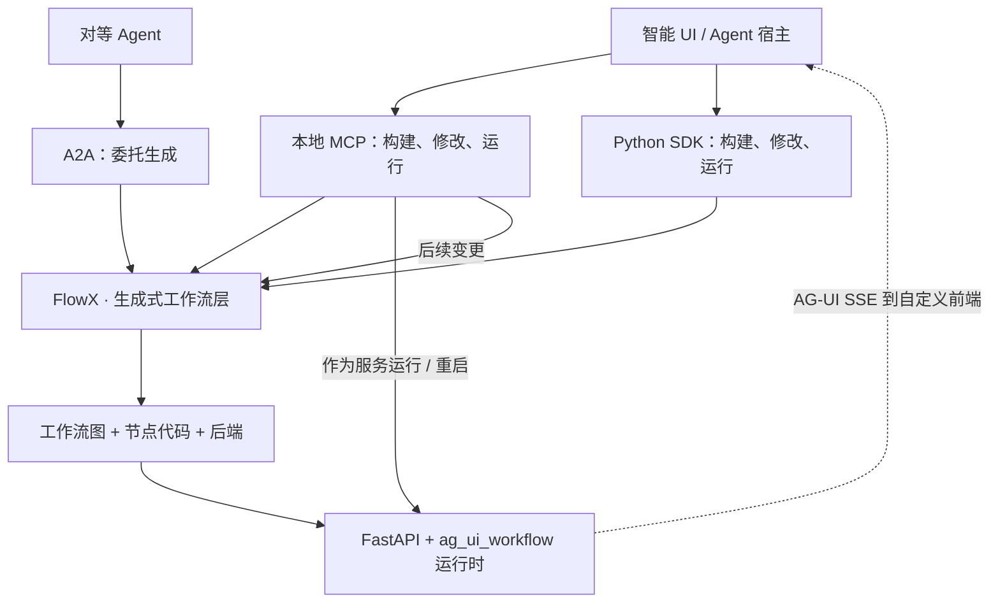
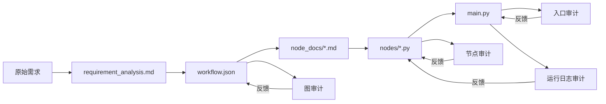

<a name="readme-top"></a>

<p align="center">
  
</p>

<h2 align="center">FlowX</h2>
<h3 align="center">用自然语言生成、运行和演进 AI Agent 工作流</h3>

<p align="center">
  <a href="README.md">English</a> · <strong>简体中文</strong>
</p>

<p align="center">
  
  
  
  
  <a href="https://github.com/AIpRoBuilder/FlowX/stargazers"></a>
  <a href="https://hub.xerj.org/contributors/xiechuxi"></a>
</p>

<p align="center">
  <a href="#quickstart">🚀 快速开始</a> ·
  <a href="#key-features">✨ 核心特性</a> ·
  <a href="#tool-surface">🧰 MCP 工具</a> ·
  <a href="#python-sdk">🐍 Python SDK</a> ·
  <a href="#a2a-server">🤝 A2A</a> ·
  <a href="#architecture">🏗️ 架构</a> ·
  <a href="docs/DYNAMIC_WORKFLOW.md">📖 文档</a> ·
  <a href="README.md">English</a>
</p>

FlowX 是一个让 AI Agent 构建、运行和演进工作流的 **MCP 服务器、Python SDK 与 A2A 适配器**。用自然语言描述一个流程，FlowX 会将其编译为工作流图（`workflow.json`）、经过审计与测试的 Python 节点实现，以及可直接运行的 FastAPI 后端。Agent 可以在同一段对话中查看产物、启动服务、输入步骤参数并演进工作流，使它成为可复用的流程，而不是一次性的回答。

<p align="center"><strong>描述 → 生成 → 检查 → 运行 → 演进 → 复用</strong></p>

**原始上游：** [AIpRoBuilder/FlowX](https://github.com/AIpRoBuilder/FlowX) ·
[署名说明](NOTICE) · [源码来源与验证](docs/PROVENANCE.md)。
FlowX 仍采用 Apache-2.0 许可证；欢迎符合许可证要求的 Fork 与复用。

<a name="news"></a>
## 📣 更新动态

- **[2026.10.28]** 🧩 **扩展节点引擎。** 每个业务节点在发布前都会执行“生成 → 审计 → 测试 → 有界修复”链路。
- **[2026.10.24]** ⚙️ **原生 WorkflowEngine 生成。** 图、节点和入口生成工作流现在都是 `WorkflowEngine` 的子类。
- **[2026.10.22]** 🚀 **交互式运行时。** `run_service` 返回可连接的 `base_url`；MCP 新增 `run_step` 与 `reset_session`。
- **[2026.10.20]** 🛠️ **引导式节点修复。** 节点测试失败后，可以结合用户指导进行修正并重试。
- **[2026.10.19]** 🔁 **演进 API。** `evolve` / `evolve_workflow` 可以作用于整个工作流、单个节点，或由引擎自行判断。

<a name="why-flowx"></a>
## 🌟 为什么选择 FlowX？

FlowX 是面向 AI Agent 的 **生成式工作流层（Generative Workflow layer）**：它把意图变成可执行的流程，而不是一次性的聊天回答。流程会以显式的图结构和代码保存下来，因此 Agent 可以检查它、运行它，并只修改真正需要变化的部分。

| 传统方式 | FlowX 提供的能力 |
| --- | --- |
| 一次性的聊天回答 | 保存在 `workspace/workflows/<workflow_id>` 下的可复用工作流 |
| 手工绘制、静态的流程 | 从意图生成、经过审计与测试、可编辑的图结构和节点代码 |
| 每次从零重新提示 | 只重建受影响节点的后续变更 |
| 托管式黑盒 | 可在任何支持 MCP 的客户端、Python SDK 或 A2A 中使用的本地 Apache-2.0 引擎 |

<p align="center">
  
</p>

*示意演示，并非真实录屏。你现有的 Agent 仍然是助手；FlowX 在对话背后提供工作流能力。消息与逐节点卡片用于说明宿主 UI 可以如何呈现，与传输方式无关。FlowX 不捆绑该界面，也不会自动生成这些卡片布局。生成与执行时间为示意值。参见[分镜与渲染说明](assets/README-demo.md)。*

### FlowX 所处的位置

**生成式 UI 塑造交互，生成式工作流塑造执行。** FlowX 专注于后者：Agent 可以在聊天、任务面板或其他智能界面背后构建、运行和修改的显式流程。

| 层级 | 职责 |
| --- | --- |
| 智能 UI / Agent 客户端 | 捕获意图并呈现进度、输入与结果。界面由宿主应用负责。 |
| **FlowX：生成式工作流** | 将意图转换为工作流产物；提供检查、执行和演进这些产物的工具。 |
| 工作流运行时 | 使用 [ag_ui_workflow](https://github.com/AIpRoBuilder/ag_ui_worflow) 在 FastAPI 后端中执行生成的节点；通过 AG-UI SSE 暴露步骤事件。 |

FlowX 与模型和 UI 无关。你可以连接支持 MCP 的 Agent 客户端、调用 Python SDK，或通过 A2A 委托工作流生成。自定义前端可以消费生成后端的事件；如何渲染这些事件由前端负责。FlowX 不暗示与特定模型或智能 UI 的专用集成。

> [!NOTE]
> 主要交互路径是本地 stdio MCP。MCP 与 Python SDK 暴露同一套引擎：构建或修改 `workflow.json` 与需求、节点、主入口或整个工作流；然后将其作为服务运行并输入步骤参数。A2A 适配器目前仅暴露非流式工作流构建。FlowX 是工作流层，不是托管式 UI 产品。

<a name="key-features"></a>
## 🚀 核心特性

- 🧩 **意图 → 可执行工作流** —— 生成工作流图、节点文档、Python 节点代码与后端入口。
- 🛡️ **审计、测试、可自修复的节点** —— 每个业务节点都会经过生成、审计、测试与有界修复；仍然失败的节点不会被发布。
- 🔁 **对话式演进** —— 可以修改整个工作流或指定节点；未变化的节点会被复用。SDK 调用方可以引导失败节点的修复。
- 🚀 **本地执行闭环** —— 通过 MCP 或 SDK 启动和停止工作流；通过 MCP 输入步骤参数并重置会话。
- 🔌 **三种接口** —— 本地 stdio MCP、Python SDK 与非流式 A2A 适配器共享同一核心。
- 📦 **可复用、版本化产物** —— 工作流保存在 `workspace/workflows/<workflow_id>` 下，可随时重新打开并继续演进。
- 🧠 **与模型和 UI 无关** —— 可连接任意支持 MCP 的客户端或你自己的前端；FlowX 不捆绑 UI。

<a name="table-of-contents"></a>
## 📑 目录

- [📣 更新动态](#news)
- [🌟 为什么选择 FlowX？](#why-flowx)
- [🚀 核心特性](#key-features)
- [⚙️ 安装与配置](#setup)
  - [安装](#installation)
  - [配置环境](#configure-the-environment)
  - [启动 MCP 服务器](#start-the-mcp-server)
  - [在 MCP 客户端中注册 FlowX](#register-flowx-in-an-mcp-client)
- [⚡ 快速开始](#quickstart)
- [🧰 MCP 工具列表](#tool-surface)
- [🐍 Python SDK](#python-sdk)
- [🤝 A2A 服务器](#a2a-server)
- [🏗️ 架构](#architecture)
  - [运行时拓扑](#runtime-topology)
  - [仓库结构](#repository-layout)
  - [产物流转](#artifact-flow)
- [🧪 运行时兼容性](#runtime-compatibility)
- [🙏 致谢](#acknowledgements)
- [🤝 参与贡献](#contributing)
- [💬 联系方式](#contact)
- [📜 许可证与来源](#license-provenance)
- [⭐ Star 历史](#star-history)

<a name="setup"></a>
## ⚙️ 安装与配置

### 前置要求

- **Python 3.10 或更高版本。**
- 用于本地 stdio 路径的支持 MCP 的 Agent 客户端。
- 兼容 OpenAI API 的 LLM 提供商（默认使用 DeepSeek）。

<a name="installation"></a>
### 安装

一次安装即可获得共享核心、MCP 适配器、Python SDK 与 A2A 适配器。

#### pip

```bash
# 创建并激活虚拟环境
python3.10 -m venv .venv
source .venv/bin/activate

# 安装 FlowX 及其运行时依赖
python -m pip install --upgrade pip
python -m pip install -e .
```

<details>
<summary>Poetry、uv 或 conda</summary>

```bash
# Poetry
poetry env use python3.10
poetry install

# uv
uv sync

# conda
conda env create -f environment.yml
conda activate flowx
```

</details>

<details>
<summary>使用本地 ag_ui_workflow 代码检出安装</summary>

FlowX Agent 位于 `packages/core/flowx_core`。只有 [ag_ui_workflow](https://github.com/AIpRoBuilder/ag_ui_worflow) 仍是外部工作流运行时依赖。如果要使用本地代码检出而不是 Git 依赖，请先安装它，再以无依赖方式安装 FlowX。

```bash
python3.10 -m venv .venv
source .venv/bin/activate
python -m pip install --upgrade pip
python -m pip install -e ../ag_ui_worflow --no-deps
python -m pip install -e . --no-deps
```

使用 Poetry 或 uv：

```bash
# Poetry
poetry env use python3.10
poetry install
poetry run pip install -e ../ag_ui_worflow --no-deps

# uv
uv venv --python 3.10
uv pip install --python .venv/bin/python -e ../ag_ui_worflow --no-deps
uv pip install --python .venv/bin/python -e . --no-deps
```

</details>

在源码检出目录中运行时，FlowX 会自动发现每个 `packages/*` 组件。仅当外部 `ag_ui_workflow` 源码尚未安装时，才需要设置 `FLOWX_EXTRA_PATHS`。

<a name="configure-the-environment"></a>
### 配置环境

```bash
cp .env.example .env
```

至少设置 `FLOWX_LLM_PROVIDER`、`FLOWX_LLM_MODEL`、`FLOWX_LLM_API_KEY` 和 `FLOWX_DEFAULT_WORKSPACE`。

```dotenv
FLOWX_LLM_PROVIDER=deepseek
FLOWX_LLM_MODEL=deepseek-flash
FLOWX_LLM_API_KEY=
FLOWX_DEFAULT_WORKSPACE=./.flowx_workspaces
```

安装后的 `flowx-mcp` 可以通过 `FLOWX_CONFIG_ROOT` 解析仓库检出目录之外的 `.env` 文件。`FLOWX_EXTRA_PATHS` 可以指向本地 [ag_ui_workflow](https://github.com/AIpRoBuilder/ag_ui_worflow) 源码，用于尚未安装到当前环境的情况。

<a name="start-the-mcp-server"></a>
### 启动 MCP 服务器

```bash
# 默认本地 stdio 入口
flowx-mcp

# 详细日志
flowx-mcp --verbose

# 源码检出入口
python3.10 run_server.py
```

如果环境未激活，在交互式终端中使用时请加上 `poetry run` 或 `uv run` 前缀。配置 MCP 客户端时，请使用下面描述的绝对可执行路径与参数；MCP 宿主可能不会继承你 shell 的 `PATH`。

<a name="register-flowx-in-an-mcp-client"></a>
### 在 MCP 客户端中注册 FlowX

```jsonc
{
  "mcpServers": {
    "flowx": {
      "command": "flowx-mcp",
      "env": {
        "FLOWX_LLM_PROVIDER": "deepseek",
        "FLOWX_LLM_MODEL": "deepseek-flash",
        "FLOWX_LLM_API_KEY": "<your key>",
        "FLOWX_DEFAULT_WORKSPACE": "/Users/user/Desktop/codes/flowx_workspaces"
      }
    }
  }
}
```

<a name="quickstart"></a>
## ⚡ 快速开始

“描述 → 生成 → 检查 → 运行 → 演进”的闭环可以在任何本地支持 MCP 的 Agent 客户端中完成。

### 1. 描述工作流

```text
Use flowx to build a workflow.

Build a workflow that accepts a support ticket, classifies its category,
assigns a priority, and drafts a reply. Name the reply node draft_reply.
Return the category, priority, and draft reply as structured output.
```

### 2. 构建并检查

Agent 会调用 `build_workflow`（或分阶段调用 `build_workflow_json`、`build_nodes` 和 `build_main_entrypoint`）来创建工作流图、节点实现与后端。使用 `list_workflows`、`list_nodes` 和 `get_workflow` 检查工作流 ID、节点 ID 与产物位置。具体步骤 ID 来自生成的工作流，而不是固定的演示 schema。

### 3. 运行、演进与复用

```text
Run the workflow as a service.

Update the draft_reply node: for urgent tickets, include an escalation note.
Then rerun the service.
```

`run_service` 启动或重启生成的服务。`run_step` 向运行中的服务输入某个步骤的参数，并在工作流暂停等待更多输入时返回状态；`reset_session` 取消暂停的运行。`evolve_workflow` 可以修改整个工作流（`target="workflow"`）、某个节点（`list_nodes` 返回的 step id 或 node id），或由引擎自行判断。

这正是区别所在：Agent 不只是回答当前工单，而是构建并演进处理下一张工单的流程。

<a name="tool-surface"></a>
## 🧰 MCP 工具列表

这些 MCP 工具让宿主 Agent 在同一段对话中操作工作流层。UI 渲染刻意留给宿主负责。

| 类别 | 工具 | 用途 |
| --- | --- | --- |
| 构建 | `build_workflow_json` | 创建（不传 `workflow_id`）或修改 `workflow.json` 及其需求分析。 |
| 构建 | `build_nodes` | 构建工作流节点，或按 step id 修改指定节点；未变化的节点会被复用。 |
| 构建 | `build_main_entrypoint` | 基于最新节点创建或重新生成主入口。 |
| 构建 | `build_workflow` | 从请求和/或运行日志创建或修改整个工作流；后续阶段会跟随前面的变更。 |
| 构建 | `evolve_workflow` | 演进现有工作流（`target="workflow"`）或单个节点（step id 或 node id）；不传 `target` 时由引擎判断。 |
| 运行时 | `run_service` | 将构建好的工作流作为服务运行并返回 `base_url`；再次调用会使用最新文件重启服务。 |
| 运行时 | `run_step` | 向运行中的服务输入某个步骤的参数；工作流暂停等待更多输入时返回 `awaiting`。 |
| 运行时 | `reset_session` | 取消暂停的会话，使下一次 `run_step` 开始全新运行。 |
| 运行时 | `stop_service` | 停止工作流正在运行的服务。 |
| 检查 | `list_workflows` | 列出工作流 ID、节点 ID、版本和未解决的错误。 |
| 检查 | `list_nodes` | 列出工作流的节点（step id、node id、版本）；可作为 `evolve_workflow` 的目标。 |
| 检查 | `get_workflow` | 定位工作流的需求、`workflow.json`、节点版本和主入口。 |

<a name="python-sdk"></a>
## 🐍 Python SDK

无需 MCP 传输，直接在 Python Agent 或你自己的智能 UI 后端中嵌入工作流构建能力。完整示例见 [examples/sdk_quickstart.py](examples/sdk_quickstart.py)。

```python
from flowx_sdk import FlowXClient

with FlowXClient(workspace="./workflows") as flowx:
    created = flowx.build_workflow_json(
        "Build a workflow that categorizes and prioritizes support tickets.",
    ).raise_for_failure()                                  # workflow.json + requirements
    workflow_id = created.workflow_id
    flowx.build_nodes(workflow_id).raise_for_failure()     # all nodes, or {step_id: amendment}
    flowx.build_main_entrypoint(workflow_id).raise_for_failure()
    flowx.build_workflow("Also return a summary.", workflow_id=workflow_id)  # whole engine
    print(flowx.run_service(workflow_id))                  # run / rerun as a service
```

每次构建调用都会返回 `AgentResult`，其中包含各阶段结果、未解决的错误、日志与产物路径；阶段失败会记录在结果中，而不是直接抛出。

向 `build_nodes`、`build_workflow` 或 `evolve` 传入 `repair_input_callback=...`，可以在节点测试失败后引导修正。回调会收到包含节点 step id、尝试次数、pytest 日志与测试结果的 `NodeRepairInput`，并返回要与日志结合的指导、`"skip"`（跳过本次修正）或 `""`（仅使用日志）。可运行示例见 [examples/sdk_guided_repair.py](examples/sdk_guided_repair.py)。

要修改现有工作流，可使用 `evolve(workflow_id, command, target=...)` 选择演进目标。`list_nodes` 会返回每个节点的 step id 与 node id；不传 `target` 时由引擎判断命令指向哪一部分。可运行示例见 [examples/sdk_evolve.py](examples/sdk_evolve.py)。

如需对扩展后的 `DynamicWorkflowOrchestrator` 引擎进行不依赖 LLM 的直接冒烟测试，请参见 [examples/dynamic_workflow_orchestrator.py](examples/dynamic_workflow_orchestrator.py)。它覆盖逐节点生成/修复链、finalizer ID 以及增量业务图更新。

```python
from flowx_sdk import WORKFLOW_TARGET

nodes = flowx.list_nodes(workflow_id)   # [{"step_id": ..., "node_id": ..., "version": ...}]
flowx.evolve(workflow_id, "Add a language-detection step.", target=WORKFLOW_TARGET)  # the workflow
flowx.evolve(workflow_id, "Validate empty input.", target=nodes[0]["step_id"])       # one node (step id or node id)
flowx.evolve(workflow_id, "Also return a one-line summary.")                         # engine judges
```

<a name="a2a-server"></a>
## 🤝 A2A 服务器

通过非流式 Agent2Agent 端点，让另一个 Agent 将工作流生成委托给 FlowX：

```bash
flowx-a2a --host 127.0.0.1 --port 8001
```

它在 `/.well-known/agent-card.json` 提供 A2A Agent Card，在 `/a2a`（以及 `/`）提供 JSON-RPC。支持的方法有 `message/send`、`tasks/get` 和 `tasks/cancel`。发送 A2A 文本消息即可构建工作流；添加 `metadata.workflowId` 可修改现有工作流。所有阶段成功时任务状态为 `completed`，否则为 `failed`；两种情况下都会携带结果，包括生成的产物路径。

<a name="architecture"></a>
## 🏗️ 架构

生成式工作流层包含一个共享核心和三种面向 Agent 的接口：`flowx_core` 负责规划、生成、审计和运行工作流；`flowx_mcp`、`flowx_sdk` 与 `flowx_a2a` 将这些能力提供给不同的 Agent 宿主。生成后的运行时位于该层之下，智能 UI 位于该层之上。



<a name="runtime-topology"></a>
### 运行时拓扑

<div align="center">
  
</div>

- `flowx_mcp.server` 通过 FastMCP 在 stdio 上暴露工具接口。
- `flowx_core.AgentBuilder` 持有由 LLM 驱动的生成工作流；`AgentWorkflowEngine` 将每个请求依次推进到 reformat、graph、node 和 main-entrypoint 阶段。
- `flowx_core.DynamicWorkflowOrchestrator` 将每个业务节点展开为生成、审计、测试和有界修复步骤，然后发布版本化产物。
- `flowx_sdk.FlowXClient` 与 `flowx_a2a` 调用同一 Agent 核心，无需经过 MCP。
- 生成的 `main.py` 会作为每个工作流独立的 FastAPI 子进程运行。
- `run_service` 启动或重启生成的 `main.py`；`run_step` 与 `reset_session` 通过 HTTP 和 AG-UI SSE 驱动交互式运行。

<a name="repository-layout"></a>
### 仓库结构

| 路径 | 导入名 | 职责 |
| --- | --- | --- |
| `packages/core` | `flowx_core` | 请求引擎、图与节点生成、审计、修复编排与服务监管。 |
| `packages/mcp` | `flowx_mcp` | 本地 stdio MCP 服务器与工具接口。 |
| `packages/sdk` | `flowx_sdk` | 用于构建、演进、检查和运行工作流的 Python 客户端。 |
| `packages/a2a` | `flowx_a2a` | 非流式 A2A 适配器。 |
| `docs` | — | 动态工作流、运行时兼容性与来源说明。 |
| `tests` | — | 跨包布局与来源检查。 |

<a name="artifact-flow"></a>
### 产物流转

工作流编译是生成式工作流层的核心机制。规划与代码生成将意图转化为产物；审计在生成过程中和运行时提供反馈。下面的产物流程图与 [assets/architecture.mmd](assets/architecture.mmd) 保持一致。



<a name="runtime-compatibility"></a>
## 🧪 运行时兼容性

FlowX 面向请求作用域的 `ag_ui_workflow` API，已针对上游修订 `0319046`（2026-10-23）验证，包括 `StepMeta` 步骤元数据契约。贡献者可参阅 [docs/RUNTIME.md](docs/RUNTIME.md) 了解契约细节。

<a name="acknowledgements"></a>
## 🙏 致谢

FlowX 感谢 [CGraph](https://github.com/ChunelFeng/CGraph) 为工作流执行提供运行时 DAG 引擎框架。

<a name="contributing"></a>
## 🤝 参与贡献

欢迎提交 Issue 和 Pull Request。如果 FlowX 对你有帮助，欢迎给仓库点 Star、分享你生成的工作流，或提交一个你希望转化为工作流的意图。

当你重新分发或修改 FlowX 时，请保留 [LICENSE](LICENSE) 与 [NOTICE](NOTICE) 署名（参见 [docs/PROVENANCE.md](docs/PROVENANCE.md)）。

<a name="contact"></a>
## 💬 联系方式

有兴趣为 AI Agent 构建生成式工作流层，或将其连接到智能 UI？欢迎通过 [peterxcx@gmail.com](mailto:peterxcx@gmail.com) 联系。

微信二维码：


<a name="license-provenance"></a>
## 📜 许可证与来源

FlowX 采用 [Apache License 2.0](LICENSE) 许可证。在遵守其条款的前提下允许重新分发与修改；重新分发 FlowX 源码时，请保留 [NOTICE](NOTICE) 署名与[源码来源](docs/PROVENANCE.md)记录。

**原始上游：** [AIpRoBuilder/FlowX](https://github.com/AIpRoBuilder/FlowX)。

<a name="star-history"></a>
## ⭐ Star 历史

[](https://star-history.com/#AIpRoBuilder/FlowX&Date)

> 中文版为英文 README 的翻译；如有差异，以[英文版](README.md)为准。

<p align="right">
  <a href="#readme-top">↑ 返回顶部 ↑</a>
</p>
