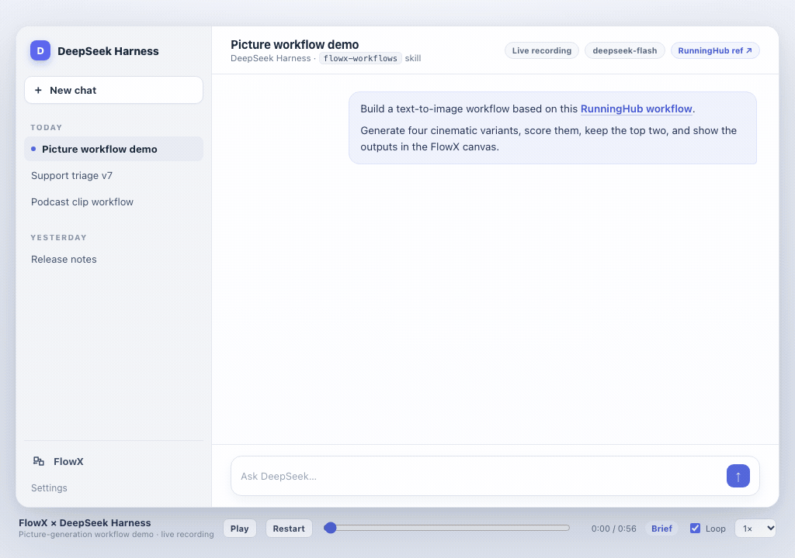
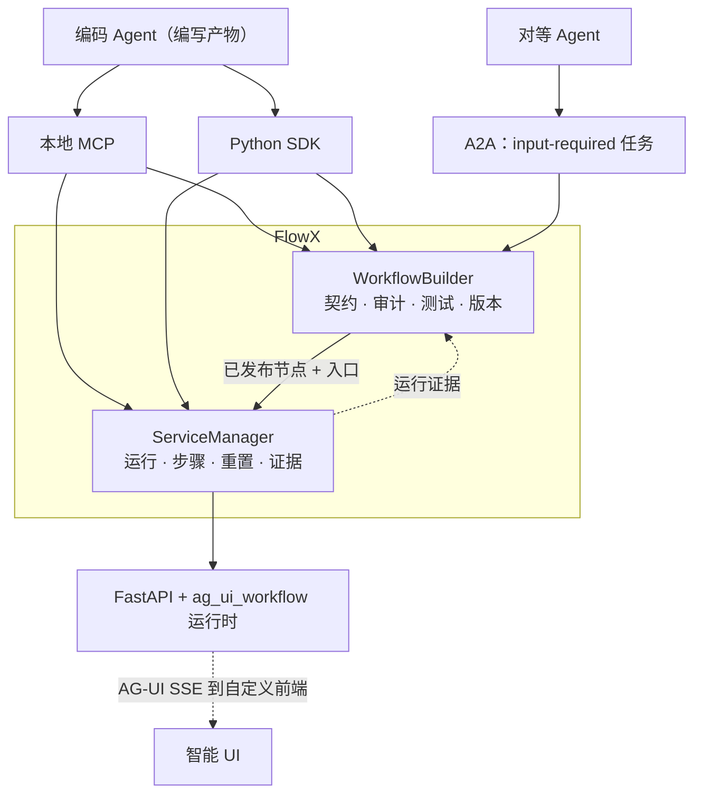
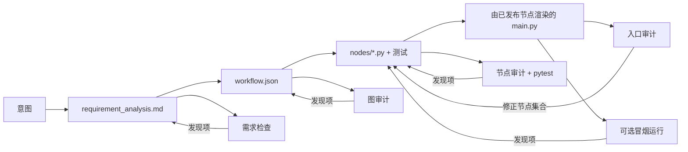

<a name="readme-top"></a>
<!-- Modified 2026-11-03: document workflow-indexed background builds and review. -->
<!-- Modified 2026-11-02: clarify SDK repair behavior and paused-result fields. -->
<!-- Modified 2026-11-03: document the background-only MCP build interface. -->
<!-- Modified 2026-11-03: document installation of the FlowX agent skill. -->
<!-- Modified 2026-11-03: add Hermes Agent skill installation instructions. -->
<!-- Modified 2026-11-04: update skill installation for its move to the repository root. -->
<!-- Modified 2026-11-04: document first-use setup and combined Hermes installation. -->
<!-- Modified 2026-11-04: streamline setup and quick-start guidance. -->
<!-- Modified 2026-11-05: install the complete skill including SDK scripts. -->
<!-- Modified 2026-11-06: document CLI answers for paused node-test repairs. -->
<!-- Modified 2026-11-09: link to the optional DeepSeek Harness plugin. -->
<!-- Modified 2026-11-10: clarify the requested read-only Harness viewer. -->
<!-- Modified 2026-11-11: document optional named workflow allocation. -->
<!-- Modified 2026-11-12: clarify Harness Web and Desktop plugin installation. -->
<!-- Modified 2026-11-16: announce media workflow support and the Harness media canvas. -->
<!-- Modified 2026-11-17: announce workflow service .env editing. -->
<!-- Modified 2026-11-20: add Discord community badge and invite link. -->
<!-- Modified 2026-11-22: FlowX no longer calls an LLM; document the agent-driven workflow builder and service manager. -->

<p align="center">
  
</p>

<h2 align="center">FlowX</h2>
<h3 align="center">由你的编码 Agent 编写工作流，FlowX 负责审计、测试、版本化和运行</h3>

<p align="center">
  <a href="README.md">English</a> · <strong>简体中文</strong>
</p>

<p align="center">
  
  
  
  
  <a href="https://discord.com/invite/KHnDtNqxp"></a>
  <a href="https://github.com/AIpRoBuilder/FlowX/stargazers"></a>
  <a href="https://hub.xerj.org/contributors/xiechuxi"></a>
</p>

<p align="center">
  <a href="#setup">⚙️ 安装配置</a> ·
  <a href="#quickstart">🚀 快速开始</a> ·
  <a href="#key-features">✨ 核心特性</a> ·
  <a href="#tool-surface">🧰 MCP 工具</a> ·
  <a href="#python-sdk">🐍 Python SDK</a> ·
  <a href="#a2a-server">🤝 A2A</a> ·
  <a href="#architecture">🏗️ 架构</a> ·
  <a href="docs/DYNAMIC_WORKFLOW.md">📖 文档</a> ·
  <a href="https://discord.com/invite/KHnDtNqxp">💬 Discord</a> ·
  <a href="README.md">English</a>
</p>

FlowX 通过 MCP、Python SDK 或 A2A 让 AI Agent **构建、运行和演进工作流**。FlowX 自身不调用模型：它为每个产物（需求、工作流图、每个节点一个任务）向你的编码 Agent 下发*契约*，审计并测试返回的内容，发布带版本的节点，渲染 FastAPI 后端并运行它。

<p align="center"><strong>描述 → 生成 → 检查 → 运行 → 演进 → 复用</strong></p>

**原始上游：** [AIpRoBuilder/FlowX](https://github.com/AIpRoBuilder/FlowX) ·
[署名说明](NOTICE) · [源码来源与验证](docs/PROVENANCE.md)。
FlowX 仍采用 Apache-2.0 许可证；欢迎符合许可证要求的 Fork 与复用。

<a name="news"></a>
<details>
<summary>📣 更新动态</summary>

- **[2026.11.22]** 🧭 **由 Agent 驱动构建，FlowX 内部不再有 LLM。** FlowX 现在由两部分组成：**工作流构建器**和**服务管理器**。构建器保留 `ag_ui_workflow` 流水线（需求 → 图 → 每个节点一个 Gate → 入口），但各步骤等待*你的 Agent*：每个 Gate 返回契约包，接收产物，运行审计器和节点的 pytest，然后发布版本，或返回结构化的发现项并发出修复任务。Agent 可通过 `get_build_state` 和只追加的事件日志查看每个阶段与节点状态。旧的 `start_*`/`get_build_status` MCP 工具、`evolve`/`build_*` SDK 方法、修复门控以及 LLM 提供商/API 密钥设置均已移除。详见 [docs/DYNAMIC_WORKFLOW.md](docs/DYNAMIC_WORKFLOW.md)。
- **[2026.11.16]** 🖼️ **媒体工作流支持。** 生成的节点除了结构化文本外，还可以返回 `prompt`、`image` 和 `video` 卡片。新增的 `flowx_core.media` 工具包含图像/视频服务商调用封装、Pillow 缩放与裁剪、FFmpeg 裁剪与缩放、可选的 Blender 无界面渲染（需设置 `FLOWX_ENABLE_BLENDER=1`），以及用于零成本节点测试的 `FLOWX_MEDIA_DRY_RUN=1`。媒体产物与步骤卡片会记录到 `workflows/<workflow_id>/runs/`。服务商调用可能产生费用，生成的代码与测试也不在沙箱中运行。
- **[2026.11.19]** 🎛️ **Hermes Agent 插件。**新的 [Hermes 插件](plugins/hermes-flowx/README.md)提供只读 FlowX Dashboard 标签页（可拖拽的计划图、运行日志卡片、受限媒体预览、工作流文件浏览器）以及五个 Agent 工具。它不会构建、运行或修改工作流，唯一写入的文件是 `canvas_layout.json`。使用 `hermes plugins install AIpRoBuilder/FlowX/plugins/hermes-flowx --enable` 单独安装。
- **[2026.11.16]** 🎛️ **DeepSeek Harness 插件更新。** 工作流画布现在可以预览每个节点的 `prompt`、`image` 和 `video` 卡片，并支持运行历史（**Sync outputs**）、版本过期标记、缩放与宽画布、按工作流保存的拖拽布局，以及全尺寸灯箱预览。媒体通过仅限所有者的 `/api/flowx/media` 路由以带鉴权的 HTTP `Range` 响应提供。每个工作流还提供 **Edit .env** 面板，可查看和编辑其 `service_<id>/.env` 文件，用于配置该服务专用的提供商、媒体与工具参数。详见[插件 README](plugins/deepseek-harness-flowx/README.md)。
- **[2026.11.10]** 🔑 **技能与插件更新。** DeepSeek Harness 插件不再需要填写技能目录；FlowX 技能脚本会复用插件保存的 Python 和工作区。
- **[2026.10.28]** 🧩 **扩展节点引擎。** 每个业务节点在发布前都会执行“生成 → 审计 → 测试 → 有界修复”链路。
- **[2026.10.24]** ⚙️ **原生 WorkflowEngine 生成。** 图、节点和入口生成工作流现在都是 `WorkflowEngine` 的子类。
- **[2026.10.22]** 🚀 **交互式运行时。** `run_service` 返回可连接的 `base_url`；MCP 新增 `run_step` 与 `reset_session`。
- **[2026.10.20]** 🛠️ **引导式节点修复。** 节点测试失败后，可以结合用户指导进行修正并重试。
- **[2026.10.19]** 🔁 **演进 API。** SDK 的 `evolve` 和 MCP 工作流演进能力可以作用于整个工作流、单个节点，或由引擎自行判断。

</details>

<a name="why-flowx"></a>
## 🌟 为什么选择 FlowX？

将意图转换为可编辑、可复用的流程，而不是一次性回答。后续修改工作流时，无需重建未变化的节点。

<p align="center">
  
</p>

*DeepSeek Harness 中的 FlowX 图片生成工作流实录。参见[分镜说明](assets/README-picture-demo.md)，或[打开交互式演示](assets/picture-workflow-demo.html)。*

<a name="key-features"></a>
## 🚀 核心特性

- 🧩 **契约而非提示词：**每个构建步骤返回包含契约、规则、上下文和产物槽位的任务包；代码由宿主 Agent 编写。
- 🛡️ **审计并测试每个节点**，沿用相同的审计器和 pytest；失败的节点不会发布，并以带修复建议的发现项返回。
- 👀 **随时掌握进度：**`get_build_state` 报告各阶段、每个节点的状态、待办任务和下一步动作；`get_build_events` 是事件日志。
- 🔁 **演进**整个工作流或单个节点（`target`），复用输入未变化的节点。
- 🚀 **本地运行：**可通过 MCP 或 SDK 运行；服务管理器可驱动步骤、重置会话，并返回运行证据以便下一次修复。
- 🔌 **选择接口：**本地 stdio MCP、Python SDK 或非流式 A2A（一次构建就是一个 `input-required` 任务）。
- 📦 **复用产物：**工作流保存在 `workspace/workflows/<workflow_id>` 下。
- 🧠 **自选 Agent 和 UI：**可选的 [DeepSeek Harness 插件](plugins/deepseek-harness-flowx/README.md)为 Web 和 Desktop 提供只读工作流查看器，两个配置需分别安装；创建、演进和运行工作流请使用独立的 FlowX 技能。
- 🎛️ **在 Hermes Agent 中查看：**可选的 [Hermes 插件](plugins/hermes-flowx/README.md)提供只读的 FlowX Dashboard 标签页和五个 Agent 工具；使用 `hermes plugins install AIpRoBuilder/FlowX/plugins/hermes-flowx --enable` 单独安装。

<a name="setup"></a>
## ⚙️ 安装与配置

### 前置要求

- **Python 3.10 或更高版本。**
- Git，用于获取 FlowX 及其工作流运行时依赖。
- 能编写 FlowX 所需产物的支持 MCP 的编码 Agent（或你自己的 Python / A2A Agent）。

<a name="installation"></a>
### 安装

克隆 FlowX 并安装核心、MCP 服务器、SDK 和 A2A 适配器：

#### pip

```bash
git clone https://github.com/AIpRoBuilder/FlowX.git
cd FlowX

# 创建并激活虚拟环境
python3.10 -m venv .venv
source .venv/bin/activate

# 安装 FlowX 及其运行时依赖
python -m pip install --upgrade pip
python -m pip install -e .
```

<details>
<summary>Poetry、uv 或 conda</summary>

```bash
# Poetry
poetry env use python3.10
poetry install

# uv
uv sync

# conda
conda env create -f environment.yml
conda activate flowx
```

</details>

<details>
<summary>使用本地 ag_ui_workflow 代码检出安装</summary>

如需用本地 [ag_ui_workflow](https://github.com/AIpRoBuilder/ag_ui_worflow) 源码替换 Git 安装的运行时，请先安装 FlowX 及其依赖，再以无依赖方式安装本地运行时：

```bash
python3.10 -m venv .venv
source .venv/bin/activate
python -m pip install --upgrade pip
python -m pip install -e .
python -m pip install -e ../ag_ui_worflow --no-deps
```

使用 Poetry 或 uv：

```bash
# Poetry
poetry env use python3.10
poetry install
poetry run pip install -e ../ag_ui_worflow --no-deps

# uv
uv sync
uv pip install --python .venv/bin/python -e ../ag_ui_worflow --no-deps
```

</details>

在源码检出目录中运行时，FlowX 会自动发现每个 `packages/*` 组件。仅当外部 `ag_ui_workflow` 源码尚未安装时，才需要设置 `FLOWX_EXTRA_PATHS`。

<a name="configure-the-environment"></a>
### 配置环境

```bash
cp .env.example .env
```

编辑 `.env`，设置工作区：

```dotenv
FLOWX_DEFAULT_WORKSPACE=./.flowx_workspaces
```

FlowX 不需要模型密钥。服务商和媒体变量（例如 `FLOWX_IMAGE_API_KEY`）只用于你生成的工作流，请放在进程环境或该工作流服务自己的 `.env` 中。

安装后的 `flowx-mcp` 可以通过 `FLOWX_CONFIG_ROOT` 解析仓库检出目录之外的 `.env` 文件。`FLOWX_EXTRA_PATHS` 可以指向本地 [ag_ui_workflow](https://github.com/AIpRoBuilder/ag_ui_worflow) 源码，用于尚未安装到当前环境的情况。

SDK 和 A2A 服务器读取进程环境变量，不会自动加载此 `.env` 文件。请导出配置，或在创建客户端前由应用加载该文件。例如，在 macOS/Linux 的仓库根目录运行：

```bash
set -a; source .env; set +a
```

<a name="start-the-mcp-server"></a>
### 启动 MCP 服务器

```bash
# 默认本地 stdio 入口
flowx-mcp

# 详细日志
flowx-mcp --verbose

# 源码检出入口
python3.10 run_server.py
```

环境未激活时，请加上 `poetry run` 或 `uv run` 前缀。MCP 宿主通常会自行启动服务器；上述命令可用于检查入口。

<a name="register-flowx-in-an-mcp-client"></a>
### 在 MCP 客户端中注册 FlowX

将可执行文件替换为虚拟环境中 `flowx-mcp` 的绝对路径，并设置工作区。MCP 宿主可能不会继承 shell 的 `PATH`。

```jsonc
{
  "mcpServers": {
    "flowx": {
      "command": "/absolute/path/to/your/venv/bin/flowx-mcp",
      "env": {
        "FLOWX_DEFAULT_WORKSPACE": "/absolute/path/to/flowx_workspaces"
      }
    }
  }
}
```

请按 MCP 客户端的安全指南保存工作流所需的凭据，避免将其提交到仓库。

<a name="install-the-flowx-agent-skill"></a>
### 安装 FlowX Agent Skill

<details>
<summary>可选：为 VS Code 或 Hermes Agent 安装技能</summary>

[FlowX 工作流技能](skills/flowx-workflows/SKILL.md)可以指导兼容的编程 Agent
构建、检查、修复、运行和演进工作流。使用前请将其安装到技能目录中。

如需在**项目**中使用（包括本项目），请在 FlowX 源码仓库根目录执行以下命令，
并将示例路径替换为目标项目的绝对路径：

```bash
TARGET_PROJECT=/absolute/path/to/your/project
mkdir -p "$TARGET_PROJECT/.github/skills/flowx-workflows"
cp -R skills/flowx-workflows/. "$TARGET_PROJECT/.github/skills/flowx-workflows/"
```

也可以在 FlowX 源码仓库中执行以下命令，为当前 VS Code 用户安装：

```bash
mkdir -p ~/.copilot/skills/flowx-workflows
cp -R skills/flowx-workflows/. ~/.copilot/skills/flowx-workflows/
```

以上命令会覆盖目标位置已有的同名文件，请先检查或备份本地修改。其他 Agent 宿主可能使用不同的技能
目录，请参阅其文档。重新分发该技能时，请保留署名及适用的 FlowX
[LICENSE](LICENSE) 和 [NOTICE](NOTICE)。

在支持技能的 Agent 中打开目标工作区，然后请求它使用 FlowX；支持技能斜杠命令的
宿主也可以调用 `/flowx-workflows`。如果未发现技能，请重新加载工作区。安装技能
会复制指导说明和脚本，但不会安装 SDK；首次使用时，如果缺少 FlowX，Agent 可以将其安装到合适的
Python 环境中。MCP 服务器注册仍需单独完成。请参阅
[安装](#installation)、[环境配置](#configure-the-environment)和
[MCP 注册](#register-flowx-in-an-mcp-client)。通过 pip 安装 FlowX 不会自动安装 Agent Skill。

#### Hermes Agent

安装 [Hermes Agent](https://hermes-agent.nousresearch.com/docs/user-guide/features/skills)
后，可以从公开 GitHub 仓库安装该技能：

```bash
hermes skills install AIpRoBuilder/FlowX/skills/flowx-workflows
hermes skills list
```

在 Hermes 对话中也可以输入
`/skills install AIpRoBuilder/FlowX/skills/flowx-workflows`。请先检查技能，
并在提示时确认安装；然后开始新会话或刷新技能，调用 `/flowx-workflows`。GitHub
安装命令要求该技能已提交并推送到仓库的默认分支，无法安装尚未发布的本地修改。

如需在 macOS 或 Linux 上一次安装 FlowX 和该技能，请确保已安装 Git、Hermes 和
Python 3.10+，然后执行以下命令。命令会创建独立虚拟环境，并拒绝复用已有路径：

```bash
python3 -c 'import sys; assert sys.version_info >= (3, 10), "Python 3.10+ required"' && \
  test ! -e "$HOME/.flowx/venv" && \
  test ! -L "$HOME/.flowx/venv" && \
  python3 -m venv "$HOME/.flowx/venv" && \
  "$HOME/.flowx/venv/bin/python" -m pip install 'git+https://github.com/AIpRoBuilder/FlowX.git' && \
  hermes skills install AIpRoBuilder/FlowX/skills/flowx-workflows
```

请检查并确认 Hermes 的安装提示，然后查看输出。如果某一步失败或拒绝安装，虚拟
环境可能仍然存在；重试前请先检查。该命令不会注册 MCP 或配置凭据。注册 MCP 时，
使用 `$HOME/.flowx/venv/bin/flowx-mcp` 作为可执行文件；使用 SDK 时，使用
`$HOME/.flowx/venv/bin/python`。

如需将当前本地检出安装到默认 Hermes 配置，在 FlowX 仓库根目录执行以下命令
（请先备份已有的目标文件）：

```bash
mkdir -p ~/.hermes/skills/flowx-workflows
cp -R skills/flowx-workflows/. ~/.hermes/skills/flowx-workflows/
```

对于命名配置或自定义 Hermes 主目录，请改用对应配置的技能目录。手动复制不会使用
Hermes Hub 安装或更新跟踪。该技能与 FlowX MCP 服务器及其配置是独立的。

</details>

<a name="quickstart"></a>
## ⚡ 快速开始

完成[安装与配置](#setup)后，向支持 MCP 的编码 Agent 发送请求：

### 1. 描述工作流

```text
Use flowx to build a workflow.

Build a workflow that accepts a support ticket, classifies its category,
assigns a priority, and drafts a reply. Name the reply node draft_reply.
Return the category, priority, and draft reply as structured output.
```

### 2. Agent 使用 FlowX 构建

1. `create_workflow(name="Ticket Triage")` 分配文件夹和 `workflow_id`（安全的单个文件夹名，且不能覆盖已有路径）。
2. `begin_build(workflow_id, intent)` 打开一个构建修订并返回 `next_tasks`：契约包，其中包含 `contract`（说明、规则、schema）、`context`、`meta` 和 `submit.slots`。
3. Agent 编写每个产物并调用 `submit_task(workflow_id, task_id, artifacts)`：先是 `requirement`，然后是 `graph`，再是每个节点一个任务（`code` 和 `test`）。相互独立的节点会同时处于待办状态。
4. 被拒绝时返回 `findings`（`rule_id`、`message`、`line`、`remediation`）、节点测试结果和修复任务（`attempt + 1`）。Agent 只需修复这些发现项；达到 `max_attempts` 后节点标记为 `failed`，其后代标记为 `blocked`。
5. `get_build_state` 显示各阶段、每个节点的状态、`next_action` 和未解决的 `errors`；`get_build_events(since=seq)` 读取事件日志。`status` 为 `completed` 时，每个节点都已审计、测试并发布，入口也已渲染并审计。

构建状态保存在 MCP 服务器进程和 `build/events.jsonl` 中；重启后再次调用 `begin_build` 即可：已发布的节点会被复用，只会重新请求未完成的工作。提交的节点测试会在本地用 pytest 运行，冒烟测试或服务运行会执行生成的代码；运行前请先检查。

### 3. 运行、演进与复用

```text
Run the workflow as a service.

Update the draft_reply node: for urgent tickets, include an escalation note.
Then rerun the service.
```

`run_service` 启动或重启生成的服务并等待其响应。`run_step` 输入某个步骤的参数，并在工作流暂停等待更多输入时返回状态；`reset_session` 取消暂停的运行；`get_evidence` 返回最新的运行记录和服务日志尾部。修改工作流时调用 `begin_build(workflow_id, intent=<变更>, target=...)`，`target` 可以是 `"workflow"`（重做需求和图）或 `list_nodes` 返回的节点名或 `node_id`；输入发生变化的后代会被重新请求，其余全部复用。

<a name="tool-surface"></a>
## 🧰 MCP 工具列表

这些 MCP 工具让宿主 Agent 在同一段对话中操作 FlowX 的两个实体。UI 渲染刻意留给宿主负责。

| 实体 | 工具 | 用途 |
| --- | --- | --- |
| 构建器 | `create_workflow(name=None, brief='')` | 创建空工作流，可指定文件夹名和 `workflow_id`。 |
| 构建器 | `begin_build(workflow_id, intent, target=None, stages=None, runtime_evidence=None, fastapi_port=None, fastapi_host=None, smoke_test=False)` | 打开构建修订；返回状态和首批契约任务。 |
| 构建器 | `get_build_state(workflow_id)` | 各阶段、节点状态、待办任务摘要、`next_action` 和未解决的错误。 |
| 构建器 | `get_tasks(workflow_id, compact=False)` | 重新读取待办契约任务的完整内容。 |
| 构建器 | `submit_task(workflow_id, task_id, artifacts)` | 提交一个任务的产物；通过则发布，被拒绝则返回发现项和修复任务。 |
| 构建器 | `get_build_events(workflow_id, since=0, limit=200)` | 某个序号之后的构建事件日志。 |
| 构建器 | `reopen_stage(workflow_id, stage, step_id=None, reason='')` | 在新修订中重做需求（连同图）、图、某个节点或入口。 |
| 构建器 | `abort_build(workflow_id, reason='')` | 取消当前修订；已发布的版本会保留。 |
| 服务 | `run_service`、`stop_service`、`service_status` | 启动（或替换）、停止和检查工作流服务。 |
| 服务 | `run_step`、`reset_session` | 向运行中的服务输入某个步骤的参数；取消暂停的会话。 |
| 服务 | `list_runs`、`get_run`、`get_evidence` | 读取运行记录，并为下一次修复收集证据。 |
| 检查 | `list_workflows`、`list_nodes`、`get_workflow`、`describe_workflow` | 工作流 ID、版本和错误；step id 和 node id；产物位置；步骤描述、输入格式和输入模式。 |

<a name="python-sdk"></a>
## 🐍 Python SDK

无需 MCP 传输，直接在 Python Agent 或你自己的智能 UI 后端中嵌入工作流构建能力。`FlowXClient` 提供与 MCP 工具相同的协议；`build()` 用你提供的函数回答每个任务，直至构建结束，你的模型或编辑器就接在这个函数里。完整示例见 [examples/sdk_quickstart.py](examples/sdk_quickstart.py)。

```python
from flowx_sdk import FlowXClient

def solve(task: dict) -> dict:
    # task["contract"]、task["context"]、task["meta"]、task["submit"]["slots"] 说明需要编写什么。
    # 返回 {槽位: 文本}：{"requirement": ...}、{"graph": ...} 或 {"code": ..., "test": ...}。
    return my_agent.write(task)

with FlowXClient(workspace="./workflows") as flowx:
    workflow_id = flowx.create_workflow("ticket-triage")
    state = flowx.build(workflow_id, "Categorize and prioritize support tickets.", solve)
    assert state["status"] == "completed", state["errors"]
    print(flowx.run_service(workflow_id))                  # 作为服务运行
    input("Press Enter to stop the service... ")
```

使用服务时请保持客户端打开；退出 `with` 代码块会停止该客户端启动的服务并取消未完成的构建（已发布的版本会保留）。

运行已构建的工作流前，`flowx.describe_workflow(workflow_id)` 返回工作流用途以及每个步骤的描述、`inputs_format`、`input_mode` 和 `input_example`。用它判断某一步需要字符串、JSON 对象还是文件路径。

需要更细粒度控制时直接使用协议：`begin_build`、`get_tasks`、`submit_task`（结果包含 `accepted`、`findings`、`test`、`next_tasks` 和 `state`）、`get_build_state`、`get_build_events`、`reopen_stage` 和 `abort_build`。可运行的修复示例见 [examples/sdk_guided_repair.py](examples/sdk_guided_repair.py)。

### 在终端中驱动构建器

没有 MCP 的 Agent 可以使用技能的构建脚本：它保持一个客户端存活，并以 JSON 行使用相同的协议。在仓库根目录运行：

```bash
python skills/flowx-workflows/scripts/build.py --workspace "$WS"
```

它先输出 `{"event":"ready"}`，之后每条标准输入行都会得到一条响应行：

```json
{"op":"begin_build","workflow_id":"ticket-triage","intent":"Categorize and prioritize support tickets."}
{"op":"submit_task","workflow_id":"ticket-triage","task_id":"requirement:requirement:r1:a1","artifacts":{"requirement":{"file":"/tmp/requirement.md"}}}
```

产物值可以是 `{"file": path}`，表示从文件读取文本。整个构建过程中请保持该进程运行；`python build.py --help` 列出所有命令。详情参阅[技能说明](skills/flowx-workflows/SKILL.md)和[构建器文档](docs/DYNAMIC_WORKFLOW.md)。

要修改现有工作流，调用 `begin_build(workflow_id, intent, target=...)`，`target` 为 `"workflow"` 或 `list_nodes` 返回的 step id / node id；未变化的节点会被复用。可运行示例见 [examples/sdk_evolve.py](examples/sdk_evolve.py)。

<a name="a2a-server"></a>
## 🤝 A2A 服务器

通过非流式 Agent2Agent 端点，让另一个 Agent 与 FlowX 一起构建工作流：

```bash
flowx-a2a --host 127.0.0.1 --port 8001
```

它在 `/.well-known/agent-card.json` 提供 A2A Agent Card，在 `/a2a`（以及 `/`）提供 JSON-RPC。支持的方法有 `message/send`、`tasks/get` 和 `tasks/cancel`。一次构建就是一个 A2A 任务：发送文本消息即可开始（`metadata.workflowId` 修改已有工作流，`metadata.target` 选择 `workflow` 或某个节点）。有契约任务待办时，任务处于 `input-required`，其状态消息以 data part 携带这些任务；请在同一 `taskId` 上发送消息回答，其 data part 为 `{"task_id": ..., "artifacts": {...}}`（或 `{"submissions": [...]}`）。构建完成时任务为 `completed`，构建失败时为 `failed`，`tasks/cancel` 后为 `canceled`；完成的任务会携带产物位置。

<a name="architecture"></a>
## 🏗️ 架构

FlowX 是两个实体加三种面向 Agent 的接口。`flowx_core.builder`（**WorkflowBuilder**）向宿主 Agent 下发契约，用审计器和 pytest 验证返回的内容，发布版本并渲染服务；`flowx_core.service`（**ServiceManager**）运行并驱动结果。`flowx_mcp`、`flowx_sdk` 与 `flowx_a2a` 将两者提供给不同的 Agent 宿主。生成后的运行时位于下方，智能 UI 位于上方。



<a name="repository-layout"></a>
### 仓库结构

| 路径 | 导入名 | 职责 |
| --- | --- | --- |
| `packages/core` | `flowx_core` | `builder`（契约、Gate、审计发现项、版本、入口渲染）、`service`（服务管理器）、审计器和原生引擎辅助工具。 |
| `packages/mcp` | `flowx_mcp` | 本地 stdio MCP 服务器与工具接口。 |
| `packages/sdk` | `flowx_sdk` | 用于构建、检查和运行工作流的 Python 客户端。 |
| `packages/a2a` | `flowx_a2a` | 非流式 A2A 适配器。 |
| `docs` | — | 构建器协议、运行时兼容性与来源说明。 |
| `tests` | — | 跨包布局、技能与来源检查。 |

<a name="artifact-flow"></a>
### 产物流转

产物由 Agent 编写，FlowX 为每一个设置 Gate。下面的流程图与 [assets/architecture.mmd](assets/architecture.mmd) 保持一致。



<a name="runtime-compatibility"></a>
## 🧪 运行时兼容性

FlowX 面向请求作用域的 `ag_ui_workflow` API，已针对上游修订 `0319046`（2026-10-23）验证，包括 `StepMeta` 步骤元数据契约。贡献者可参阅 [docs/RUNTIME.md](docs/RUNTIME.md) 了解契约细节。

<a name="acknowledgements"></a>
## 🙏 致谢

FlowX 感谢 [CGraph](https://github.com/ChunelFeng/CGraph) 为工作流执行提供运行时 DAG 引擎框架。

<a name="contributing"></a>
## 🤝 参与贡献

欢迎提交 Issue 和 Pull Request。如果 FlowX 对你有帮助，欢迎给仓库点 Star、分享你生成的工作流，或提交一个你希望转化为工作流的意图。

当你重新分发或修改 FlowX 时，请保留 [LICENSE](LICENSE) 与 [NOTICE](NOTICE) 署名（参见 [docs/PROVENANCE.md](docs/PROVENANCE.md)）。

<a name="contact"></a>
## 💬 联系方式

有兴趣为 AI Agent 构建生成式工作流层，或将其连接到智能 UI？欢迎通过 [peterxcx@gmail.com](mailto:peterxcx@gmail.com) 联系。

微信二维码：


<a name="license-provenance"></a>
## 📜 许可证与来源

FlowX 采用 [Apache License 2.0](LICENSE) 许可证。在遵守其条款的前提下允许重新分发与修改；重新分发 FlowX 源码时，请保留 [NOTICE](NOTICE) 署名与[源码来源](docs/PROVENANCE.md)记录。

**原始上游：** [AIpRoBuilder/FlowX](https://github.com/AIpRoBuilder/FlowX)。

<a name="star-history"></a>
## ⭐ Star 历史

[](https://star-history.com/#AIpRoBuilder/FlowX&Date)

> 中文版为英文 README 的翻译；如有差异，以[英文版](README.md)为准。

<p align="right">
  <a href="#readme-top">↑ 返回顶部 ↑</a>
</p>
