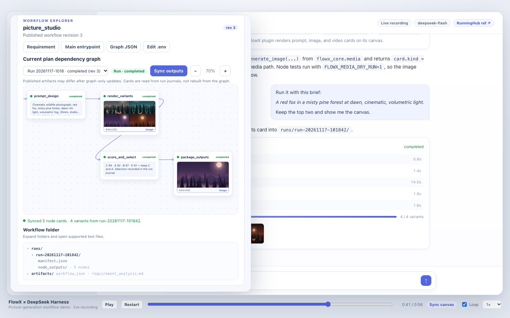
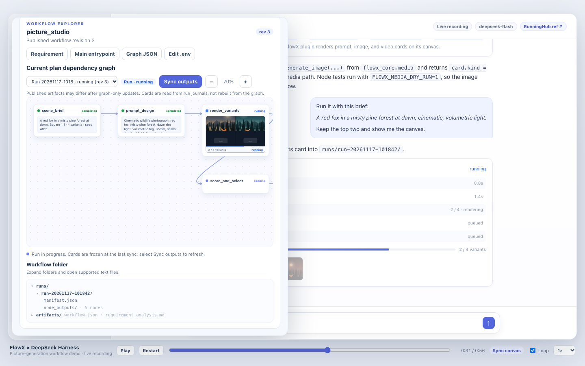

# Picture-generation workflow demo

[picture-workflow-demo.gif](picture-workflow-demo.gif) is a **~57-second, 1024 × 720, 2.5 fps looping recording** of this walkthrough. [picture-workflow-demo.html](picture-workflow-demo.html) is the interactive version: it is a text-to-image workflow built with the FlowX `flowx-workflows` skill and inspected in the **DeepSeek Harness** FlowX plugin canvas. Open the HTML directly in a browser; it has no build step.



*Live recording. Preview at 0:41.6 with the completed run synced into the compact canvas.*

## What it shows

The demo follows one continuous Harness conversation:

1. **Generate the workflow.** The agent uses the FlowX skill to turn a scene brief into a five-node graph, generate and test each node in dry-run, and build the service entrypoint.
2. **Run the workflow.** The generated service streams node state into `runs/run-20261117-101842/`. The `render_variants` node uses `flowx_core.media` and writes an image card; `score_and_select` keeps two finalists; `package_outputs` writes the album card and manifest.
3. **Sync the plugin canvas.** The FlowX sidebar action opens the workflow explorer. Selecting **Sync outputs** loads the run journal, including live node state and per-node prompt and image cards. The canvas freezes at the last sync until the user syncs again.
4. **Inspect the result.** The demo expands the canvas, previews the contact sheet and selected image, and closes with the published workflow and run paths.

The canvas during the generating process (0:31.6) shows completed prompt cards, a partial contact sheet, and a running `render_variants` card. The canvas is frozen at the last sync; it does not auto-refresh while the run continues.



*At 0:31.6 the first sync loaded the in-progress run journal.*

The reference cited in the demo is [RunningHub workflow 2122580909429194754](https://www.runninghub.ai/workflow/2122580909429194754). The graph follows a text-to-image → score → package pattern and is not a copy of the remote workflow.

## Storyboard

| Time | Phase | What to watch |
| --- | --- | --- |
| 0–2s | Brief | The user asks for four cinematic variants and the FlowX canvas. |
| 2–17s | Generate | `requirement_analysis.md`, `workflow.json`, five node tests, and the FastAPI entrypoint appear as build stages. |
| 17–29s | Run | The run card advances through `scene_brief`, `prompt_design`, `render_variants`, `score_and_select`, and `package_outputs`; variants appear as they finish. |
| 29–31s | Open canvas | The FlowX overlay opens with the plan graph; **Sync outputs** loads the in-progress run. |
| 31–42s | Synced while running | The canvas shows completed prompt cards, a partial contact sheet, and a running `render_variants` card. The canvas stays frozen at the last sync while the chat progresses. |
| 42–50s | Full sync | A second sync loads the completed journal: all five node cards, the contact sheet, the scores, and the selected album image. The canvas expands for inspection. |
| 50–56s | Summary | The overlay closes and the final message reports the published revision and output paths. |

## Recording

The README GIF is a 56.6-second, 1024 × 720, 2.5 fps loop of the walkthrough. It follows the same timeline as the interactive page and holds the final frame for one second.

## Controls

- **Pause / Play**, **Restart**, timeline scrubber, loop toggle, and 0.5×/1×/2× speed.
- Click any image card to open a larger preview. Press **Escape** to close the preview or the overlay.
- Click a node to show its description, dependencies, and status.
- **Sync outputs** reloads the canvas from the latest run journal. If used before the automatic sync point, it advances to that state.
- **Expand canvas** / **Compact view** toggles the full-width overlay.

For still frames, the page exposes a small helper:

```js
flowxDemo.seek(44);   // pause at 0:44 and render that state
flowxDemo.play();
flowxDemo.pause();
flowxDemo.time();     // current seconds
```

You can also open the page paused at a specific frame with URL parameters:

```text
picture-workflow-demo.html?t=41.6           # pause at 0:41.6
picture-workflow-demo.html?t=41.6&static=1  # pause with transitions disabled
```

The preview still uses the compact canvas at 0:41.6 so the Harness conversation and the FlowX overlay are visible together. At 0:44 the demo shows the expanded canvas with all synced cards.

## Design notes

- The four variants change palette, light, composition, and fox direction so the contact sheet and selection read as distinct outputs.
- The plugin styling follows the real viewer: `FlowX · workflow & media canvas`, `Sync outputs`, run selector, zoom, expand, node status dots, prompt cards, image cards, and the workflow folder tree.
- The demo deliberately shows the manual sync model: the canvas does not auto-refresh while a run is in progress. A second **Sync outputs** is required to load the completed journal.
- Use the separate FlowX skill to generate workflows and the plugin to inspect their actual artifacts and run journals.

## Files

- `picture-workflow-demo.gif` — 56.6-second, 1024 × 720 looping GIF used by the READMEs.
- `picture-workflow-demo.html` — standalone interactive demo.
- `picture-workflow-demo-running.png` — preview at 0:31.6 with the in-progress run journal synced onto the canvas.
- `picture-workflow-demo.png` — preview at 0:41.6 with the completed run synced into the compact canvas.
- `README-picture-demo.md` — this storyboard.
